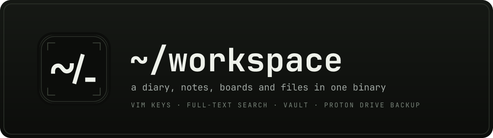
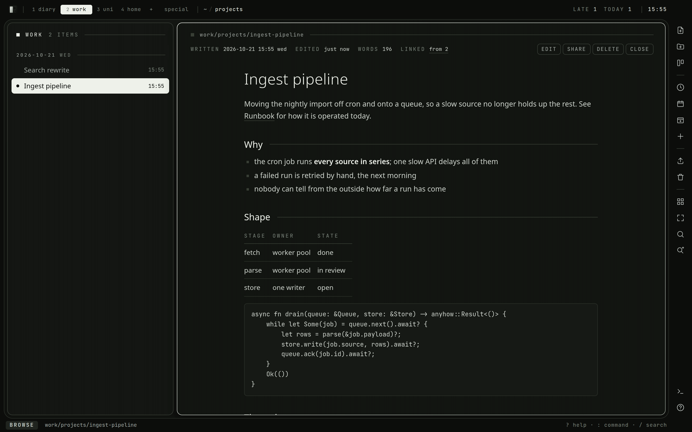
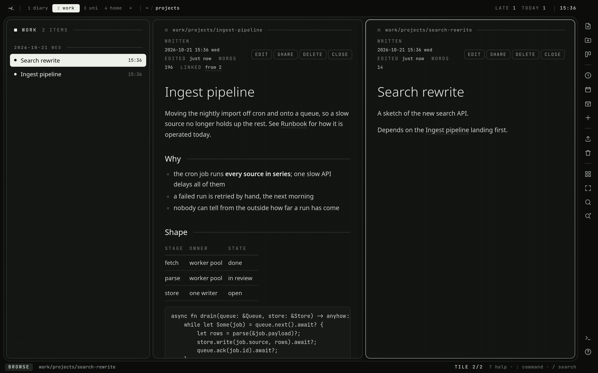
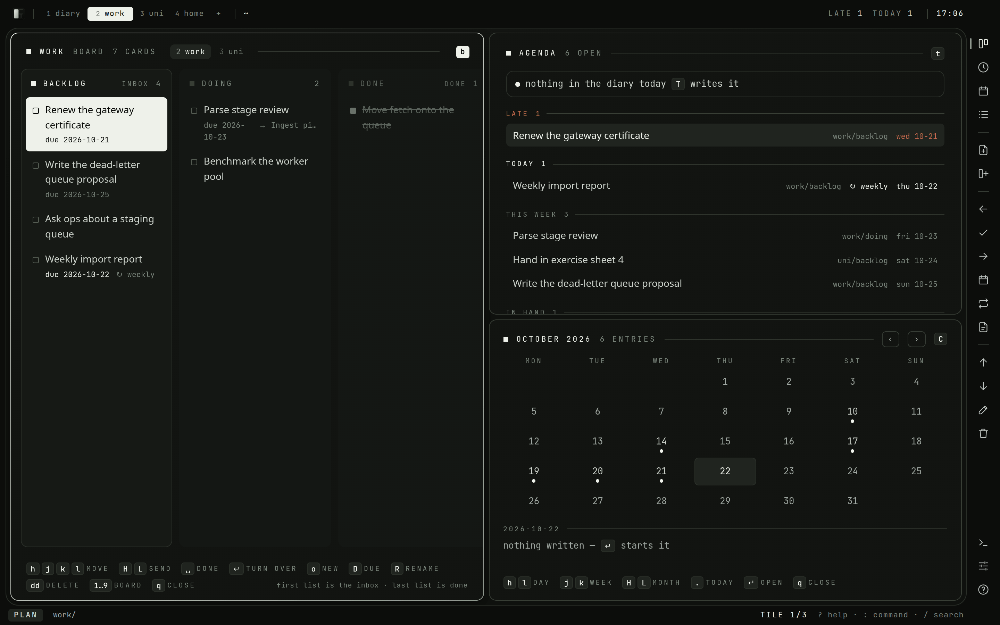
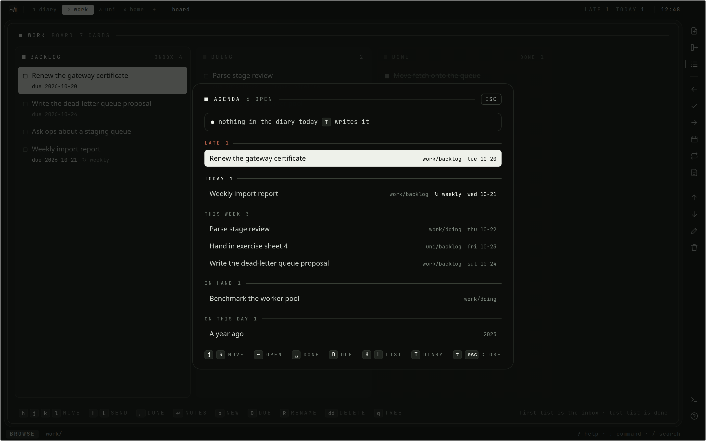
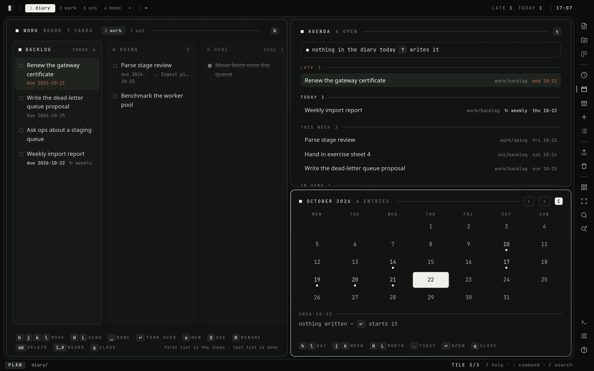
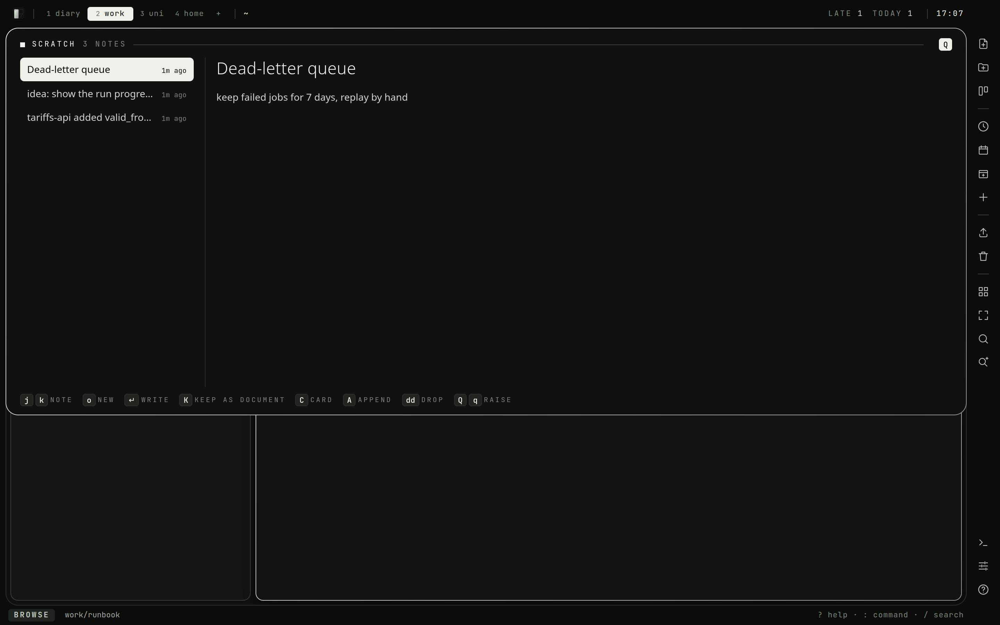
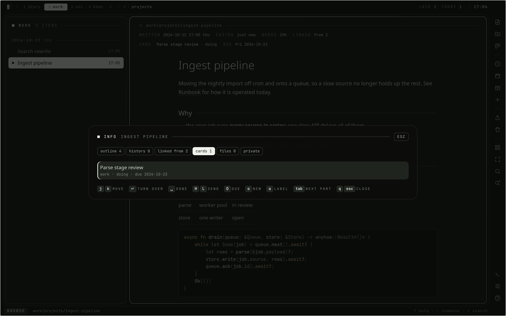

<p align="center">
  
</p>

<p align="center">
  <a href="https://github.com/narrrl/narl-workspace/actions/workflows/ci.yml"></a>
  <a href="https://github.com/narrrl/narl-workspace/wiki"></a>
  
  
</p>

# ~/workspace

A private, terminal-themed workspace that runs in the browser: a diary, the
notes for work and for uni, a board per space, and the files that go with them.
One user, one SQLite file, one binary. It was called `narl-diary` until it grew
everything but the diary.



**New here?** The [guide](docs/wiki/Guide.md) walks through a day with it, and
[getting started](docs/wiki/Getting-Started.md) has it running in five minutes.
Everything is also in the [wiki](https://github.com/narrrl/narl-workspace/wiki).

## What it does

Four things, each in one place: **documents**, the thorough record, in the tree
of a space; **cards**, the short actionable summary of work, on the board of a
space, usually about a document; **notes**, jotted in passing, on the
scratchpad until they become one of the others; and **diary entries**, one
document per day. A file sits in a folder or belongs to its document.

- **Write.** Markdown documents in spaces (`diary`, `work`, `uni`, …) with
  folders to any depth. Real vim keys on the desktop (CodeMirror 6), plain taps
  on a phone. Math by KaTeX, `$x^2$` and `$$…$$`, and ` ```typst ` blocks
  typeset by Typst on the server. `[[Title]]` links that are
  rewritten when what they point at is renamed or moved, and backlinks.
- **Plan.** A kanban board per space, cards with a checklist, labels and a
  markdown description, linked to their document both ways, due dates said the way you say them
  (`fri`, `+3d`), cards that come back once done, and an agenda of what is late,
  due or in hand on every board.
- **Remember.** A diary with a calendar, templates, the entries from this day
  in earlier years, and an evening reminder when nothing was written.
- **Keep files.** PDFs, archives and recordings live in the tree beside the
  notes about them, streamed to disk however large. PDFs, text, code, tables
  and certificates open in place, and search reads the text files too.
- **Find.** Full-text search across a space or all of them, documents, files,
  cards and notes alike (SQLite FTS5).
- **Lose nothing.** Autosave that survives a dropped network, every earlier
  version of a document as a diff, a trash with undo, an export that reads
  without this app, and an import that takes it back.
- **Seal.** A vault: files sealed with AES-256-GCM under a password that is
  never stored.
- **Jot.** A scratchpad that drops down over whatever is on screen, even
  mid-sentence, for notes taken in passing; one key makes a note a document, a
  card, or more of a document.
- **Capture.** A token per phone or script that puts a card in an inbox, a
  note on the scratchpad or a line in today's entry, and nothing else.
- **Install.** On a phone the workspace installs as an app: it opens with no
  network, sits in the share sheet, where whatever is shared to it lands on
  the scratchpad, and back closes one thing at a time.
- **Share.** Any document behind an unguessable, revocable read-only link.
- **Mount.** The whole workspace over SFTP, for an editor on another machine.
- **Back up.** A mirror to Proton Drive, end-to-end encrypted, as a registered
  device, and mail for reminders, due cards and a weekly digest.
- **Deploy.** Rust and axum on the server, Svelte 5 in the browser, and the
  whole frontend embedded in the release binary, so deploying is copying one
  file.

| | |
| --- | --- |
|  |  |
|  |  |
|  |  |
|  |  |

## Quick start

```sh
cp .env.example .env      # set WORKSPACE_USER, WORKSPACE_PASSWORD and WORKSPACE_SECRET
make build                # builds the frontend, then the release binary
./target/release/narl-workspace
```

Then open <http://127.0.0.1:4242>.

Every setting is read as `WORKSPACE_<NAME>`, with the older `DIARY_<NAME>`
spelling still accepted behind it, so a server configured before the rename
keeps running untouched.

`WORKSPACE_SECRET` signs the session cookie; generate one with
`openssl rand -base64 32`. Changing it logs every device out, and so does
changing `WORKSPACE_PASSWORD` or `:logout!`, which ends every session but
needs no restart. Every signed-in browser is a row on the server: `:sessions`
(or `,`, the settings sheet) lists them and `:sessions rm <n>` signs one out — a lost phone, say — without
touching the rest, and locks the vault as well. A setting that is set but cannot be read — a number out of
range, a switch that is neither on nor off — stops the start with the reason,
rather than being taken for its default. The database and
uploads live under `WORKSPACE_DATA_DIR` (`./data` by default) — that directory is
the entire backup, and it is exactly what the Proton Drive mirror copies.

### Development

```sh
make dev-api   # cargo run, serving the API on :4242
make dev-web   # vite dev server on :4243, proxying /api to :4242
```

In debug builds the binary reads `web/dist` from disk, so `cargo run` alone also
works once the frontend has been built at least once. Before that it compiles,
tests and runs the API, and answers every page with "frontend not built".

`make check` runs what CI runs: format, clippy, the tests, svelte-check, and a
check that the generated wiki pages are current. The wiki is written in
`docs/wiki` and published by CI on every push to `main`; `make wiki`
regenerates the pages read out of the code, and `make screenshots` takes the
pictures in `docs/images` again. See
[Development](docs/wiki/Development.md).

## Keys

The desktop UI is modal, and a key acts on whatever has focus: in the list
that is the row under the cursor, even while another document is open beside
it; in the document pane it is that document. In the browse pane:

| key | action |
| --- | --- |
| `1` … `9`, `0` | switch to that space |
| `Shift-1` … `9` | send the marked nodes, or the selected one, to that space |
| `Tab`, `Shift-Tab` | next / previous space |
| `w` | overview of every space; `hjkl` then `Enter` |
| `f` | fullscreen the focused pane, or the focused tile |
| `Ctrl-h/j/k/l` | focus the tile in that direction, from the editor too; `Ctrl-h` past the leftmost tile focuses the list |
| `h` / `l` | while reading, the tile to the left / right; `h` past the leftmost goes to the list |
| `Ctrl-Shift-h/j/k/l` | move the focused tile that way |
| `L`, `Shift-Enter` | open the highlighted row in a new tile instead of the focused one |
| `gt` / `gT` | next / previous tile, in the editor too |
| `q` | close the document, and its tile when there are several (`:close`); asks first if its draft could not be written |
| `j` / `k` | move down / up, or scroll the document when it has focus |
| `gg` / `G` | first / last entry, or top / bottom of the document; a first `g`, `d`, `]` or `[` shows in the status line for a second while it waits for the second key |
| `Ctrl-D` / `Ctrl-U` | half a page down / up the open document |
| `zl` / `zh`, `zL` / `zH` | scroll the table, code block or formula at the top of the view sideways, a little or by half its width |
| `]]` / `[[` | the next / previous heading of the open document, in the editor too |
| `gi` | the info sheet: the open document's headings, earlier versions, backlinks, cards, files and the share link — `Tab` goes from one part to the next (`:info`); clicking the line under the title opens it too |
| `gO` | the info sheet at the headings — `j`/`k`, `Enter` jumps there (`:outline`) |
| `gx` | open the file under the cursor in a tab of its own |
| `gh` | the info sheet at the earlier versions, as diffs — `j`/`k`, `Enter` brings one back (`:history`) |
| `gb` | the info sheet at the documents that link to the open one — `j`/`k`, `Enter` opens one (`:backlinks`) |
| `gc` | the info sheet at the cards about the open document — `j`/`k` picks one for `Space`, `H`/`L`, `:due` and `:label`, `Enter` turns it over on its board (`:cards`) |
| `F` | a letter over every link and button in view; typing it follows it — links out of the workspace open in a tab of their own |
| `Enter`, `l` | open the highlighted entry; on an open keystore or sealed file, `Enter` asks for its password |
| `o` | a new document here, straight into insert mode; when the space has templates, the line offers them first |
| `O` | a new folder here |
| `i`, `a` | edit the open entry |
| `R` | rename what is highlighted — a document, a folder or a file — starting from its name (`:space name` renames the space) |
| `m` / `p` | pick nodes up — `m` again puts one back, `M` takes the whole folder — then drop them all into the folder you walk to |
| `za` | fold a document's own files open under it in the list, or away again |
| `Ctrl`/`Shift`-click | pick a row up / every row from the cursor to it; drag picked-up rows onto a folder, a crumb or a space |
| `S` | the plan screen with every view on it — the board, the agenda and the calendar, in place of the documents and the list — or back to the documents as they were left |
| `b` | the board of this space, alone on the plan screen or beside what is on it; a digit there shows another space's |
| `t` | the agenda: what is late, due this week, or in hand, on every board, alone on the plan screen or beside what is on it |
| `T` | today's diary entry, started if there is none |
| `C` | the diary by month (`:cal`) — see [The diary](#the-diary) |
| `[d` / `]d` | the diary entry before / after the one open, by date |
| `c` | capture a card into this space's inbox without leaving where you are — reading a document, a card about it; `Tab` on the line makes it a note, or a line in today's entry |
| `Q` | the scratchpad, lowered over whatever is on screen — see [The scratchpad](docs/wiki/Writing.md#the-scratchpad) |
| `Ctrl-Q` | from anywhere, the editor too: the scratchpad down with the last note being written, and again back to where you were, still writing (Firefox quits on it instead) |
| `Esc`, `q` | close the document, and its tile when there are several; `Esc` first puts down what `m` picked up |
| `h` | up one level in the tree |
| `/` | full-text search in this space (`:noh` clears it); `Tab` on the line takes it to every space and back, `Ctrl-N`/`Ctrl-P` walk the results without leaving the line, `Enter` opens the one lit |
| `Ctrl-P` | go to anything by its name, in every space: the last word is looked for in the name, the ones before along the path (`proj ingest`); `Tab` or `Ctrl-N`/`Ctrl-P` walk, `Enter` goes |
| `n` / `N` | the next / previous search result, opened beside the results; past the last it starts again at the first |
| `x`, `dd` | delete the entry under the cursor into the trash (asks `y`/`N`) |
| `u` | undo the last delete: it comes back out of the trash to where it was |
| `:` | command line — `Tab` / `Shift-Tab` cycle the matching commands, then the argument (folders for `:cd` and `:mv`, spaces for `:space`, options for `:set` …); `↑` / `↓` recall the lines run before that start as this one does |
| `Ctrl-S` | save from anywhere |
| `?` | help: the keys to start with, and every key and command on a second `?` |
| `,` | settings: vim and the clipboard, the vault, the backup, signed-in browsers, ssh keys and capture tokens |

Inside the editor the full vim keymap is live — `w`/`b`, `dd`, `ciw`, visual
mode, macros, `:w` to write. `:help` lists every ex command; the useful ones are
`:w`, `:wq`, `:q!`, `:new [template] [yyyy-mm-dd] [name]`, `:date`, `:name`, `:share [off|new]`,
`:upload`, `:search`, `:backup` and
`:set novim`. `:name` on its own moves up into the title; `Enter`, `Esc` or `↓`
there goes back down into the text. In the text, `]]`, `[[` and `gO` walk the
headings as they do in the reader. `gf` follows the link under the cursor, saving
first, and `gx` opens it in a new tab. `[[` in insert mode offers the titles of
documents to link to. The rest: `:today` opens today's entry, `:edit [id]` (or `:12`)
opens a node by id, `:next`, `:prev`, `:first`, `:last` and `:random` walk the
list (`:bn` and `:bp` walk the tiles), `:delete [id]` deletes, `:copy` puts the whole document on the clipboard,
`:noh` drops the search, `:trash` lists what was deleted, `:reload` re-reads the folder, `:stats` counts words
and lines, `:search!` searches every space, `:set clipboard` / `:set
noclipboard` mirrors vim yanks to the system clipboard, `:logout` ends the
session, `:logout!` every session and `:sessions rm <n>` one other, and
`:token` manages the tokens that capture from outside (see below). The tree has its own: `:space [name]` switches (`:space new <name>`
makes one, `:space rm [name]` puts one in the trash with everything in it), `:mkdir <name>`
makes a folder, `:cd <name|..|/>` walks it and `:mv <folder|..|/>` moves what is
selected, and `:import` uploads a folder into the one being browsed
(`:import zip` takes a `.zip` instead). `:upload` outside the editor puts files
into the folder being browsed, and so does dropping them on the list. `:name <text>` renames whatever is under
the cursor — a document, a folder, or a card on a board — and `:space name <text>`
renames the space itself. Two spaces cannot share a name, in any case, and no name is
longer than 200 characters. The board has
`:board`, `:card <title>` (reading a document, the card is about it),
`:due <when|->`, `:repeat <rule|->`, `:done` and `:list <name>` (`:list name` renames one, `:list rm` deletes one).

A `!` means force, or everything, and nothing else: `:w!`, `:q!`, `:search!`,
`:export!`, `:logout!`. A command that does a second thing takes a word for it
instead — `:space new`, `:share off`, `:upload seal`, `:import zip`, `:vault
unlock`. The old spellings (`:space!`, `:unshare`, `:unlock` …) still work for
one release; the [command reference](docs/wiki/Commands.md#old-spellings) lists
them.

A single line break in a document is a line break, the way it was typed. A
paragraph an editor wrapped at a fixed width — an import, a save over the mount
from vim with `textwidth` — is the exception: every line but the last is long
and each break comes where the next word would not have fitted, so it is read
as running text. Two spaces or a `\` at the end of a line always break it.

On a touch device modal editing is off by default (`:set vim` turns it on) and
the same actions are buttons: the `⋯` on a row — or a long press — opens what
the keys do to it: rename, move, share, seal, delete. A move is picked up
there and dropped with the button the dock then shows, in whichever folder
is open. Inside a folder the list starts with `..`, the way up. The dock also
has today's entry, an upload into the folder, the trash, a search across every space,
and on the board the card moves, renames and deletes; the agenda has a done
button per card.

Over HTTPS the browser offers to install the workspace (Chrome's menu: *Install
app*, or *Add to Home screen*). Installed, it opens in a window of its own, from
its own icon, and with no network it still opens, to say the server cannot be
reached and try again. Back — the gesture or the button — lets go of one thing
at a time, the way `Esc` does: a sheet, the scratchpad, the editor, the
document, then a folder up; at the root of a space it leaves the app. On
Android the installed app is in the share sheet: a link or some text shared to
it becomes a note on the scratchpad, the title on its first line, and waits
there through a login if the session has run out. A service worker keeps the
app's own files and nothing else; it never stores a document, a card or a
note.

## Tiles

Several documents can be open at once. `L` (or `Shift-Enter`) on a row opens
it in a tile of its own; `Enter` and `l` still open it in the focused tile.
Right of the list the tiles share the space the way hyprland's dwindle layout
does: two side by side, a third splits the newer one, and so on. Each keeps
its own scroll position and its own editor, and the keys always act on the
focused one. Opening a document that is already in a tile focuses that tile
rather than opening it twice.

`Ctrl-h/j/k/l` moves the focus between tiles, from the editor too, and
`Ctrl-Shift-h/j/k/l` moves the tile itself; while reading, `h` and `l` go to
the tile left and right. `gt` / `gT` and `:bn` / `:bp` cycle through them,
`:ls` lists them, `:b <n or name>` focuses one, `:close` (`q` while reading)
closes one and `:only` every other. `:next` and `:prev` still walk the list.
Each space remembers its tiles, so switching away and back finds them as they
were. Under 768px wide only the focused tile is shown.

The views — the board, the agenda, the calendar and a card's back — have a
screen of their own, the plan, which `S` goes to and comes back from; `b`, `t`
and `C` go there too, to their own view. The documents are put away behind it
as they are, and the plan stays as it is from space to space. Opening a
document from the plan — a card's notes, a day of the calendar — goes back to
the documents and opens it beside them; `q` on a view does the same, and on a
card's back goes back to the board.

## The SFTP mount

The workspace can be mounted as a filesystem over SFTP, so an editor or a file
manager on another machine works on it directly. It is off until
`WORKSPACE_SFTP_BIND` is set (`127.0.0.1:2222`, or `0.0.0.0:2222` inside a
container, with the port published in `compose.override.yml`). Only public
keys get in, and only the ones registered from inside the workspace:

```text
:sshkey add laptop ssh-ed25519 AAAA… you@laptop
:sshkey              the settings sheet's ssh keys, with their fingerprints
:sshkey rm laptop    and this one is out, mounted or not
:sshkey vault laptop on    this key may read sealed files while the vault is open
```

```sh
sshfs -p 2222 me@your-host:/ ~/workspace     # the user name is ignored
```

The root holds the spaces, `mkdir` there makes one, and anywhere else a
folder. A document is `<slug>.md`, read as `# Title` followed by its body, and a
leading heading written back renames it. The server's host key is made on first
start as `sftp_host_key` in the data directory.

## Boards

`b`, the board door on the rail, or `:board` shows the board of the space
being browsed on the plan screen — alone, or beside the views already there —
and `q` or `Esc` closes it again; closing the last view goes back to the
documents. Every space has one except the
diary — a journal has no backlog — and `:set board` / `:set noboard` changes
that for the space you are in (the dimmed board door on the rail does the
same). A new board starts with `backlog`, `doing` and `done`, and the columns mean
something by where they stand rather than by their names: the first is the
inbox new cards land in, the last is done. A card is finished exactly when it
sits in the last column — moving it there stamps it, moving it out reopens it —
so a tick and a column can never disagree; marking a card done through the API
moves it there too, and deleting the last column makes the one before it done.
`:list <name>` adds a column in front of the last one, `:list name` renames the column under the cursor, and
done cards older than a week fold away until `z` shows them.

`c` captures from anywhere: `:card <title>` outside the board puts the card in
this space's inbox (or the first space that has a board) and leaves you where
you were. `Tab` on that line makes it a note on the scratchpad instead, or a
timed line in today's diary entry (`:today <text>`). On the board, `o` or `c` puts a card on the column under the cursor.

| key | action |
| --- | --- |
| `h` / `l` | to the list on the left / right |
| `j` / `k` | down / up the cards of that list |
| `J` / `K` | move the card down / up its list |
| `H` / `L` | move the card to the list on the left / right |
| `Enter` | turn the card over, in a tile beside: labels, a markdown description, a checklist |
| `gf` | the card's notes, a document made on first use, beside; `q` comes back |
| `Space` | into the done column, or back out to the inbox |
| `o`, `c` | a new card on this list |
| `D` | due date — `fri`, `tm`, `+3d`, `+2w`, `10-31`, `2026-10-31` |
| `R` | rename the card, or the column when it has none |
| `z` | show done cards older than a week |
| `F` | a letter over every card in view; typing it puts the cursor on that card |
| `x`, `dd` | delete the card |
| `q`, `Esc` | close the board's tile |

On the back of a card, `j`/`k` walk the checklist, `Space` ticks a step, `o`
adds one and `dd` drops it; `e` writes the description in the vim editor, `:w`
saving it to the card; `a` puts a label on. Code in the description is
coloured as nvim colours it. See the
[wiki](docs/wiki/Boards-and-Agenda.md#the-back-of-a-card) for every key.

A card can point at a document: `c` or `:card` while reading one makes a card for it,
and `gf` on its back opens it again. `gf` on a card without one makes a
document named after the card — in the folder being browsed when that is in the card's space, else in its root — and opens it to write in, and
closing that document returns to the board on the same card. The link is deliberately loose —
deleting the document leaves the card standing, because the work is still open
once its notes are gone. Only a document can be a card's notes; a folder or a
file is refused.

### Cards that come back

`:repeat weekly` (or the rail's ↻ button) makes a card come back once it is
done. The rules are `daily`, `weekly`, `monthly`, `yearly`, and every `+3d`,
`+2w`, `+6m` or `+1y`; `:repeat -` stops it. Finishing the card, on the board
or in the agenda, leaves a copy at the bottom of the inbox with the same title,
notes, document and rule, due on the next date, and the status line says when.
The next date counts on from the old due date, in `WORKSPACE_TIMEZONE`, so a
card due at noon stays due at noon across a change of the clocks. A card due on
the 31st comes back on the last day of a shorter month and on the 31st again
where there is one. A card finished late skips the dates that have passed and
comes back on the first one from today on; a card without a due date counts from
the moment it was finished. The finished card gives up its rule, so reopening it
and finishing it again makes no second copy. The board and the agenda show the
rule as `↻ weekly` beside the date.

## The agenda

`t` (or `:agenda`) gathers every unfinished card from every board that is late,
due within the week, or sitting in a column between the inbox and done — the
work already in hand — and says whether the diary has an entry for today. `j`/`k`
walk it, `Enter` goes to the card on its own board, `Space` finishes it where
it stands, `D` sets its due date (`:due` on the line), `:` opens the line with
the agenda kept up so `:repeat` acts on the card, `H` / `L` send it to
the list left / right on its board, and `T` writes today's entry. The bar shows `late` and `today` counts
whenever either is above zero, and the agenda opens by itself once a day when
something is late or due, so nothing has to be remembered to be looked at.
The day is the one in `WORKSPACE_TIMEZONE`, as for the mails, so a browser on a
trip groups the cards the same way.
Below the cards it lists what the diary holds from this day in earlier years;
`j` walks on into them and `Enter` opens one. A 29 February is remembered on
the 28th in the years that have none.

## The diary

The space with the diary role is a journal: each document in it is an entry,
dated by the day it is about (`:date` changes that). `T` opens today's, `[d`
and `]d` step to the one before or after by date, and `C` (or `:cal`) shows a
month: `h` / `l` move a day, `j` / `k` a week, `H` / `L` a month, `.` goes
back to today, and `Enter` opens the day's entry or starts one dated that day.
A marked day has an entry, a number says how many. Days are counted in
`WORKSPACE_TIMEZONE`, the same as the evening reminder.

### Templates

Any space can have a folder called `templates` at its root; every document in
it is a template. `:new meeting` starts a document from `templates/meeting`,
`:new meeting 2026-10-20 Budget` dates and names it as well, and Tab completes
the template names. In a template, `{{date}}` becomes `2026-10-20`,
`{{weekday}}` `Tuesday`, `{{time}}` `14:05` and `{{title}}` the new document's
name, all on the clock of `WORKSPACE_TIMEZONE` at the date the document is
for. A new entry in the diary — from `T`, `o`, the calendar or a capture —
starts from `templates/day` when the diary has one. The templates are not
entries, so they are not on the calendar and do not count as having written
today.

## Capturing from elsewhere

A thought arrives when no tab is open. `POST /api/capture` writes it down from
anything that can send a request — a phone shortcut, a script, `curl` — with a
token in place of a session:

```text
:token add phone     makes one, shows it once and copies it
:token               the settings sheet's tokens, each with when it was last used — x there retires one
:token rm phone      and that one captures nothing from the next request on
```

```sh
curl -H "Authorization: Bearer nwc_…" -H 'content-type: application/json' \
  -d '{"text":"call the bank"}' https://your-host/api/capture
```

`"to": "card"`, the default, puts a card in an inbox: the one of the space
named by `"space": "<slug>"`, or else of the first space that has a board,
the same as `:card` outside the board. The first line is the card's title and
the rest its notes. `"to": "diary"` adds `- 14:05 call the bank` to the end of
today's entry, in `WORKSPACE_TIMEZONE`, and starts the entry when there is
none yet, from `templates/day` when the diary has one. `"to": "note"` puts it
on the scratchpad, and `"to": "document"` at the end of the document named by
`"document"`, as a link names it: `Plan`, `[[Plan]]` or `/n/work/plan`. The answer says where it went: `{"to":"card","id":7,"where":"work/backlog"}`.

A token opens this one route and nothing else — it reads nothing, not even the
list of spaces — and only its SHA-256 is kept, the way a share key is. Wrong
tokens slow down like wrong passwords, on a line of their own, so guessing at
them does not hold up the login.

On an iPhone, a Shortcut with *Ask for Input* followed by *Get Contents of
URL* does it: method `POST`, a header `Authorization` of `Bearer nwc_…`, and a
JSON body with `text` set to the input. On Android, *HTTP Shortcuts* does the
same with a text-input variable in the body. Either one goes on the home
screen, or behind the share sheet. On Android the installed app is in the share
sheet itself, with no token, and puts what is shared on the scratchpad.

## Not losing things

Every change is written to `localStorage` as it is typed and to the server a
couple of seconds after typing stops, so `:w` is a habit rather than a
necessity. When the server cannot be reached the draft stays in the browser
and the save is tried again, less often the longer it fails, and at once when
the browser says it is back online. A session that runs out mid-sentence
shows the login, and logging in again carries on where it stopped, draft and
all.

A document saved somewhere else since it was opened here — another tab, the
phone, the SFTP mount — is not written over: `:w` says so, `:e!` takes the
other version, and `:w!` writes this one anyway. Search results say which
space and folder each match is in. A document made with `o` and left with neither a name nor a word in
it is removed again on the way out, so abandoned starts do not pile up. If a tab dies mid-document, opening it again restores the draft and
says so — `:e!` throws it away, the way vim handles a swap file.

A save keeps what it replaces. `gh` or `:history` lists the open document's
earlier versions, the newest first, and shows the highlighted one as a diff
against the text as it is now: `-` is what bringing it back would take out,
`+` what it would put back. `Enter` brings it back, and the text it replaces
becomes a version of its own, so a restore is undone the same way. Autosave
writes every few seconds, so an ordinary save keeps a version at most every
ten minutes; `:w!`, a save over the SFTP mount and a restore always keep one,
because each of them may undo something. A rename alone keeps nothing. The
daily sweep forgets versions older than `WORKSPACE_REVISION_DAYS` (90 by
default), but never the newest 20 of a document, and an upload stays as long
as a version still embeds it. A file that has been sealed since is gone from
the old version — sealing deletes the plaintext on purpose. Versions are not
in the export, the mount or the readable view on Proton Drive; they are in
`diary.db`, and so in its mirror.

A delete is not the end of anything. `x`, `dd`, `:delete` and `:space rm`
put what they delete in the trash, with everything inside it, and `u` puts
the last of them back where it was — the same folder, the same name, unless
a new one took the name meanwhile. `:trash` lists everything in it, the last
deleted first: `j`/`k` walk it, `Enter` or `r` restores, `x` deletes one for
good and `:trash purge` empties it, each asking first. Something whose folder
has gone since comes back to the root of its space, and something whose space
is in the trash too waits until the space is restored. What has been in the
trash for `WORKSPACE_TRASH_DAYS` (30 by default) is deleted for good by the
daily sweep, files and all.

While it waits, a node in the trash is out of sight: not in the tree, the
search, the agenda, the mails, the SFTP mount, the export or the readable
`files/` view on Proton Drive. A card whose notes are in the trash keeps
pointing at them and finds them again after a restore, and a shared document
answers like an unknown link until it is restored — with the same link its
readers already hold.

`:export` downloads the open document as markdown. `:export!` downloads the
whole workspace as a zip: the tree as real directories, empty folders too, one
markdown file per document, every file in the tree where it sits — a
document's own files in a directory named like it, `plan/` beside `plan.md` —
under their real names, and relative links
between documents, folders and files, so the archive reads in any markdown
viewer without this application. What plain files have no place for — when
each entry was written, names as they were typed, which space is the diary,
every board with its cards and their repeat rules — goes into one
`.workspace.json` beside them. An older build reads a newer file's cards
without their rules rather than refusing it.

The diary is the diary by role, not by name: rename it and the reminder and
the agenda still know which space it is, and it cannot be deleted — empty it
instead. Before a new build migrates the database it keeps a copy of it as
it was, `diary.db.pre-<version>`, next to it in the data directory.

Every upload is a file in the tree. One pasted or dropped while writing, or
put in with `:upload` while reading a document, belongs to that document: it
moves, seals, goes to the trash and comes back with it. The info sheet lists
a document's files (`:info files`): `Enter` opens one, `i` embeds it at the
cursor while writing, `y` copies how to embed it elsewhere. In the list a
document with files says `+2`, and `za` folds them open under it, where they
are renamed, deleted and picked up like any other row; `p` with the cursor
among them drops marked files there. A file is deleted where it sits, and its
bytes stay on the disk until it leaves the trash — or for as long as another
document still embeds it. What a killed upload or a crash leaves in
`uploads/` is removed at start and once a day.

## Links

A document links to another by its address, `[the plan](/n/work/notes/plan)`,
or by its title, `[[Plan]]` or `[[Plan|the plan]]`. A title is looked for in
the space the link is written in first, then in every other; it is a name in
any case, or the slug that name has. `[[` in the editor offers the titles as
the search finds them. A title no document has yet is drawn dimmed, and
following it — a click, `F`, `gf` — offers to write that document in the
folder being browsed.

Links keep working when what they link to moves. Renaming a document, or a
folder above it, or moving either somewhere else — in the browser or over the
mount — rewrites the links to it in every document that has one, in the same
write: the path to the new one, a `[[title]]` to the new name, the label left
as it was. A rewritten document keeps a version of what it said before, like
any other save. A link to something in the trash stays as it is and follows
it when it is restored; once it is deleted for good the text of the link
stays, and leads nowhere.

`gb` or `:backlinks` lists the documents that link to the open one, each with
the line it does so on, and the line under the title says how many there are.
A link inside a card, or one written into prose rather than as a markdown
link, is not counted or rewritten. The links of the documents written before
there were any are indexed once, when the server first starts with this.

## Files

A file is a node like a document, only with bytes instead of text: it sits in
a folder, shows its size in the list, and `Enter` opens it. What is shown in
place:

- images, video and audio;
- PDFs, in the browser's own viewer;
- text and source code of any kind, recognised by its name or, failing that, by
  its first few kilobytes, with line numbers and the first 256 KiB of it;
- markdown, rendered, with `source` (or `:source`) to see it as written;
- CSV and TSV, as a table of the first 500 rows;
- certificates, keys and keystores — `.pem`, `.crt`, `.cer`, `.der`, `.csr`,
  `.key`, `.p8`, `.p12`, `.pfx` — read on the server: subject, issuer,
  validity, key, names, usage and fingerprints, and which key belongs to which
  certificate. A `.p12` or an encrypted key asks for its password, which opens
  it for that one look and is never stored. Nothing of a private key is ever
  sent back but its algorithm and size.

Anything else is a download: `:export` fetches the file under the
cursor, and `gx` opens one in a tab of its own as the browser shows it. `:name`
renames it, and the download is called whatever it is called now; `:mv`, `m`
and `p` move it; `x` deletes it. `:upload` picks files for the folder being
browsed, or drop them onto the list. Each upload is written to disk as it
arrives, never held in memory, so the only ceiling is `WORKSPACE_MAX_UPLOAD_MB`
(1024 by default) — which is per request, so a proxy in front needs a body
limit at least that large too.

### Searching inside files

`/` finds a file by what it says as well as by its name: the text
of every file that is text — by its type, or by its first 8 KiB reading as
UTF-8 without a NUL — is indexed, up to its first 256 KiB, the same part the
viewer shows. A file found that way lists the words around the match under its
name, the words that matched lit. The text is read when a file arrives, by upload, import or the SFTP
mount, again when its bytes change, and at start for any file still without
it. PDFs, office documents and images are not read.

A sealed file is never indexed. Sealing one drops its text in the same step,
a file in a sealed folder never gets any, and the database refuses it if
something tries; otherwise the plaintext would sit in `diary.db` and its
mirror beside the sealed bytes. Decrypting a file reads it again.

The SFTP mount shows files beside the documents, under their own names — a
later file that shares one is told apart by its id, `slides (42).pdf` — and
anything copied in that is not a `.md` becomes a file in the tree, streamed to
disk under the same size limit. A file copied into a sealed folder is sealed
on the way in while the vault is open in the browser. Reading one back takes
more: a key is a standing credential kept on another machine, so it reads
sealed files only once given vault access with `:sshkey vault <name> on`, and
none has it to start with. Such a key, while the vault is open, opens a sealed
file decrypted as it is read, and it is sealed again when it is saved,
wherever it sits. While the vault is shut, or once the access is taken away,
both are refused, and either cuts off a read already under way — though a
client that cached what it read keeps that copy until it lets go of it.
Nothing done over the mount holds the vault open; only the browser does. A
session holds at most 256 handles and 64 MB in memory, the server at most 32
connections, and one whose client has stopped answering is dropped within a
few minutes.
`rm` and `rmdir` over the mount put things in the trash, as a delete in
the browser does. A rename onto a name that is taken replaces what was
there, as `rename(2)` does, without keeping it in the trash: editors and
`rsync` save that way, and the trash would fill up with every save.
Editor droppings — swap files, `~` backups, dotted temp files — stay in
memory for the session, and a dotted temp file renamed onto a real name is kept
as that file, which is how `rsync` and most editors save.

If a document is saved in the browser while an SFTP client holds it open, the
client's save does not overwrite it: it lands beside it as `<name>-conflict.md`,
and both are kept. Deleting a key in the browser ends what that key mounted,
not just its next login.

## The vault

Some files deserve more than the login: scans of documents, contracts, health
records. The vault encrypts them at rest under a password of their own, so
they stay unreadable to someone who has the data directory or the Proton
account the mirror writes to, and to a logged-in browser while the vault is
shut — to anyone, in short, who does not know the vault password.

`:vault` sets the password the first time (ten characters at least) and says
whether the vault is open afterwards. `:upload seal` puts files into the folder
being browsed sealed — encrypted as they stream in, so the plaintext never
touches the disk. `:encrypt` seals the file under the cursor; `:decrypt` takes
it back out. `:vault unlock` and `:vault lock` open and close it, `:vault passwd` changes the
password. A sealed file carries a lock in the list, and the bar says `vault
open` while it is.

`:vault passwd` makes a new master key as well as a new password. The old password
stops opening anything at once; every sealed file is then re-sealed under the
new key in the background, under a new name, while the vault is open — `:vault`
shows how far it has come, and locking halfway only pauses it until the next
`:vault unlock`. The old copies are deleted from `uploads/` and, on the next mirror
run, from Proton Drive for good. After that, a copy of `diary.db` from before
the change (a `diary.db.pre-*` snapshot, an old revision in Proton Drive) and
the old password open nothing that is still kept anywhere. What they cannot
take back is a copy someone already made of the files themselves. Re-sealing
rewrites only each file's header, but every sealed file is uploaded to Proton
Drive once more. A second `:vault passwd` waits until the first has finished.

`:encrypt` on a folder or space seals it for good, not just once: every file
in it now, and every file that lands in it later. An upload, an import, an SFTP
write and a file or folder moved in are all sealed on the way in. While the
vault is shut they are refused rather than stored readable, and the browser
asks for the password instead. Folders made inside are sealed too, and a
sealed folder carries a lock like a sealed file. `:decrypt` on that folder
unseals it with everything in it; a file or folder inside it cannot be
decrypted on its own. Documents are not files and stay readable, as below.
The database holds the line as well: a file node whose bytes are not sealed
cannot be put in a sealed folder by any path.

The vault closes itself after `WORKSPACE_VAULT_IDLE_MIN` minutes of nobody
using it (15 by default) — the key is dropped from memory then, not merely
refused on the next look — on logout, and whenever the server restarts. While
it is closed a sealed file shows as sealed and nothing more; a share link never
serves one, open or not; and `:export!` refuses until it is open, because an
archive meant to be read without this application has to hold the files
opened.

How it works: Argon2id turns the password into a key that seals a random
master key, and only that sealed copy is stored. Each file gets a random key of
its own, sealed under the master key in the file's header together with its
id, and its bytes are AES-256-GCM in 64 KiB records, the last one marked as
last — so a file that is swapped, cut short or tampered with refuses to open.
Changing the password makes a new master key. Until every file is re-sealed,
the old one is kept sealed under the new one, so either kind of file opens and
an interrupted re-seal carries on where it stopped; re-sealing a file wraps its
own key under the new master key and copies its records as they are.

A sealed file is served with `Cache-Control: no-store`, so the browser keeps
no copy of what it showed once the vault shuts. A sealed image in a document
shows as a button while the vault is shut, which asks for the password and
puts the image back. `:share` says how many sealed files a document holds,
since its readers will not see them, and `:encrypt` says how many shared
documents just lost a picture to the vault. `:encrypt` on a folder seals
what it can and counts what it could not, rather than stopping at the first.

Only the bytes are sealed. A sealed file's name, and the names and text of
the documents around it, stay readable in `diary.db` — and in the mirror of
it — like everything else outside the vault.

**There is no recovery.** Forget the vault password and every sealed file is
gone — from the server and from every backup — which is exactly what makes it
worth having. The password is not in `.env`, not in `diary.db`, and not in the
mirror.

Sealing a file that already exists writes it anew under a new id, rewrites the
links of documents that embed it, and deletes the plaintext from the disk. The
mirror then deletes the old copy from Proton Drive outright — trash and all —
whatever `WORKSPACE_BACKUP_PRUNE` says, and takes the file out of the readable
`files/` view. The sealed copy goes up to `data/uploads/` like any other.
Proton cannot read either; only the vault password can read the sealed one.

## Importing a folder

`:import` picks a folder and uploads it whole — every file carries the path it
had inside, and the tree is rebuilt on the other side: directories become
folders, `.md` and `.markdown` files become documents (titled by their first
heading), anything else becomes a file in the tree. `:import zip` does the same with
a zip, which is the shape `:export!` writes. `:import zip /` pours an `:export!`
back in at the root: each directory becomes a space again — or goes into the
space already there by that name — and with `.workspace.json` beside it the
dates, names, boards and cards come back as they were, a document's files go
back to being its own — `plan/` beside `plan.md`, or the `media/` folder of an
older export — and a file that happened to end in `.md` stays a file.

Links between the imported files are rewritten as they land: a link to a
markdown file becomes the document's address, a link to an image becomes its
media URL, and anything pointing outside the upload — a URL, a file that was not
uploaded — is left exactly as it was written. Absolute paths, `..` segments and
anything a zip smuggles in are refused, and both the upload and what a zip unpacks to are bounded by
`WORKSPACE_MAX_UPLOAD_MB`.

A document has a real address, `/n/<space>/<folder>/<slug>`, which is what those
rewritten links point at and what the address bar shows, so any document can be
linked to from outside — behind the login, unlike a share link.

## Backing up to Proton Drive

The server can mirror itself into Proton Drive, where it appears as a device —
its own sync root, alongside the desktop clients — rather than as a folder
dropped in *My Files*. Everything is encrypted client-side before it leaves the
machine, by the same Rust SDK the Linux client uses, so Proton stores a
workspace it cannot read.

It is a third-party client: it identifies itself to Proton as
`external-drive-narl_workspace@<version>-alpha` and says so before it asks for
account details. It carries no Proton branding and is not supported by Proton.

Set it up once, interactively, because SRP and 2FA need a human. From the
workspace:

```text
:backup login <proton-username>
```

It shows the disclosure above and asks before anything else, then asks for the
password and, when the account has one, the two-factor code. If Proton wants a
human check first, its own page opens in a sheet; solve it and the login goes
on. An account whose only second factor is a security key cannot log in from
here — add an authenticator app to it. `:backup logout` forgets the session
again. The mirror starts within a minute of the login; no restart is needed.

The same login runs from the server's terminal, for a check that a terminal
can answer:

```sh
narl-workspace proton-login                       # or, in Docker:
docker compose exec -it workspace narl-workspace proton-login
```

That checks the password against the account's keys and stores a session —
the tokens, and the key passphrases derived from the password at login — as a
`0600` file next to the database. The password itself is never stored: the
passphrases unlock the keys but cannot log in, change the password or turn 2FA
off. They are still enough to read the account, and the file sits on the same
volume as the workspace it protects, so the volume is the thing to keep private.
A session stored by an older build, which kept the password, is rewritten
without it on the next start; no new login is needed. Built with
`--features keyring` on a host that has a Secret Service, the session goes to
the OS keyring instead and the file is only a fallback; the container has no
session bus, so there it is always the file.

In a container, `WORKSPACE_SESSION_KEY_FILE` does what the keyring would: the
file is sealed with AES-256-GCM under a key read from somewhere other than the
volume, so a copy of the volume alone is no longer a session. A Docker secret is
the place for it:

```sh
mkdir -p secrets
openssl rand -base64 32 > secrets/session.key
sudo chown 10001 secrets/session.key && sudo chmod 400 secrets/session.key
```

then the `secrets:` lines from `compose.override.yml.example`, and
`WORKSPACE_SESSION_KEY_FILE=/run/secrets/session_key` in `.env`. A plain session
already on the volume is sealed the next time it is read. Lose the key and the
session goes with it; `proton-login` makes a new one.

Afterwards the server resumes on its own and nothing prompts again. Refresh
tokens are single-use, so every rotation is written back immediately — which is
also why two servers must not share one session file.

The mirror is one-way and change-driven: a write marks the workspace dirty, and once
it has been quiet for `WORKSPACE_BACKUP_DEBOUNCE_SEC` the mirror runs, with
`WORKSPACE_BACKUP_INTERVAL_MIN` as a backstop. An hour of writing is one backup, not
sixty. The device folder ends up as a copy of the data directory:

```text
narl-workspace/          the device — Proton allows only folders in a device root
  data/              the data directory, copied
    RESTORE.txt      what this is, and how to put it back
    diary.db         a VACUUM INTO snapshot — consistent, no write-ahead log
                     (the file keeps the name it was created with)
    uploads/<uuid>   every uploaded file, under the name the database knows
  files/             every file node again, as <space>/<folder>/<name>
```

`diary.db` becomes a new revision each time, so Proton Drive keeps the older
ones and a mistake that was mirrored can still be undone. Uploads are written
once and never rewritten. Restoring is copying the contents of `data/`
back into an empty data directory — no tool in between, which is the point.

| command | what it does |
| --- | --- |
| `narl-workspace proton-login` | log in and enable backups |
| `narl-workspace proton-status` | account, device, schedule, how much is mirrored |
| `narl-workspace backup-now` | mirror once and exit — for cron, or for nerves |
| `narl-workspace proton-logout` | forget the session; the mirror stays where it is |

From inside the workspace, `:backup` (the settings sheet, `,`) says when the last one finished and `:backup!`
runs one now. A failed backup is loud: it is reported by `:backup`, and the next
tick retries it.

`files/` is for reading, not restoring: the same bytes as `data/uploads/`, laid
out the way the tree shows them, so a PDF can be opened from Proton Drive's own
apps by its name. It follows the workspace — a rename or a move there is a
rename or a move on Drive, not a second upload, and a deleted file goes to
Drive's trash whatever `WORKSPACE_BACKUP_PRUNE` says, since `data/` still has
it. Two files that share a name in a folder are told apart by the later one's
id, `slides (42).pdf`. It costs the storage of every file twice; anything put
into `files/` by hand may be trashed, because the workspace owns that folder.

Deleting an entry does not delete it from the mirror unless `WORKSPACE_BACKUP_PRUNE`
is on. A backup that forgets on command is one accident away from being no
backup at all.


## Mail

Off until `WORKSPACE_SMTP_URL` is set, and then four kinds of mail, all plain
text and all addressed to `WORKSPACE_MAIL_TO`:

| kind | when |
| --- | --- |
| `reminder` | at `WORKSPACE_REMINDER_AT`, if nothing was written in the diary space that day |
| `card_due` | at `WORKSPACE_CARD_DUE_AT`, for every card due that day, and again once it is overdue |
| `digest` | at `WORKSPACE_DIGEST_AT`: what was written per space, what was finished, what is still open |
| `login` | a browser signed in that has not signed in before, or a run of wrong passwords |

`WORKSPACE_MAIL_KINDS` is the list of kinds that may be sent; drop one to switch
it off. Every "today" is asked in `WORKSPACE_TIMEZONE`, because whether an entry
was written today depends on where you are, and a day is not always 24 hours
long where the clocks change.

Nothing is sent straight from the code that decides a mail is due. It goes into
an outbox table under a key that names the occurrence — `reminder:2026-09-18`,
`card_due:41:2026-09-20:overdue` — and a tick a minute drains it. A restart
cannot resend yesterday's reminder, because the row is already there; a relay
that refuses cannot lose one, because the row is still there and is retried with
a widening gap, up to an hour apart. After ten refusals a mail is left for
`mail-status` to show and no longer stands in front of the ones behind it.

A card mail is checked against its card before it goes: one finished, deleted
or re-dated since it was queued, or on a board that has been switched off, is
dropped unsent. Mails that are done with are forgotten after 90 days. The
reminder needs a diary to be about, and says nothing when there is none.

The login mail says *a new browser*, not *a new person*: the device is
remembered as a SHA-256 of its `User-Agent`, which is honest about what it can
tell and needs no proxy header to be trusted for it.

```sh
narl-workspace mail-test      # one mail, straight out, bypassing the outbox
narl-workspace mail-status    # what is configured, what is queued, what failed
```

SMTP settings are wrong the first time, always. `compose.override.yml.example`
carries a [mailpit](https://mailpit.axllent.org/) service for exactly that:
point `WORKSPACE_SMTP_URL` at `smtp://mailpit:1025` and read the
reminders at <http://127.0.0.1:8025> before involving a real relay.

## Sharing

`:share` mints two 192-bit random secrets and copies
`https://your-host/s/<token>#<key>`. That page needs no session, renders the
entry read-only, and serves only the media files that entry currently embeds —
dropping a picture out of a shared entry immediately makes it unreachable
through the link.

The two halves do different jobs. The token names the entry; the key proves the
reader was given the whole link. A browser never sends a fragment to the server,
so the key stays on the reader's machine and out of every access log, referrer
and link preview along the way — a crawler or a chat client that harvested only
the path holds a URL that answers `404`. The server stores nothing but a
SHA-256 of the key and compares in constant time, and a wrong key is answered
exactly like an unknown token, so guessing never confirms that a token is live.

The page sends the key on to the server once, in the body of the request that
reads the entry, never in a URL. That answer gives the browser a cookie scoped
to this one link's path, good for 12 hours, and the entry's pictures and
videos are fetched with it — so not even this server's reverse proxy logs the
key. A fresh key from `:share new`, or `:share off`, voids the cookies handed out
under the old one.

Because only the hash is kept, a link exists in full exactly once: in the moment
`:share` copies it. It cannot be re-read from the entry afterwards. `:share new`
mints a fresh key for the same token — which retires the previous link, making
it the way to cut off a reader without unpublishing — and `:share off` destroys
both halves.

## API

Everything except the login, the health check and the two share routes
requires the session cookie; `/api/capture` takes a token instead. Media answers `Range` requests, so a video seeks,
sealed or not.

| method | path | purpose |
| --- | --- | --- |
| `GET` | `/api/health` | public: up, and the database answers — for a supervisor |
| `POST` | `/api/login`, `/api/logout` | session; `/api/logout?everywhere=true` ends every one |
| `GET` | `/api/me` | current user |
| `GET` | `/api/sessions` | every signed-in browser, the one seen last first |
| `DELETE` | `/api/sessions/{id}` | sign another browser out, and lock the vault |
| `GET`/`POST` | `/api/spaces` | the spaces / create one |
| `GET`/`POST` | `/api/nodes` | children (`?parent=`) or search (`?q=`, `?space=`; a file matched by its text has `in_text` and the words around the match as `excerpt`, each matched word between U+0002 and U+0003) / create, from a template with `template_id` |
| `GET`/`PUT`/`DELETE` | `/api/nodes/{id}` | read / update only the fields sent — `name`, `body`, `created_at`, `has_board`; with `base_updated_at`, refused with `409` once it was saved since / delete into the trash, subtree and all — or for good, for something already in it |
| `GET`/`DELETE` | `/api/trash` | what was deleted, the last first / empty it |
| `DELETE` | `/api/trash/{id}` | delete one thing in the trash for good |
| `POST` | `/api/trash/{id}/restore` | back where it was deleted from, or to its space when that folder is gone |
| `GET` | `/api/spaces/{id}/board` | the lists and cards of one space |
| `GET` | `/api/agenda` | open cards due within a week or in hand, on every board, whether the diary has today, its entries `on_this_day` in earlier years, and `today` in `WORKSPACE_TIMEZONE`, with its bounds |
| `GET` | `/api/diary/days?month=2026-10` | the diary's entries in a month, each with its local `day` |
| `POST` | `/api/diary/day` | `{ day? }`: the entry of `2026-10-22`, or of today in `WORKSPACE_TIMEZONE`, started from `templates/day` when there is none; answers `{ id, created }` |
| `GET` | `/api/diary/around/{id}` | the entries before and after a diary entry, by date |
| `GET` | `/api/nodes/{id}/templates` | the templates of the space the node is in |
| `POST` | `/api/capture` | `{ text, to: "card" \| "diary" \| "note" \| "document", space?, document?, note? }`, with a session or `Authorization: Bearer` a token; `note` is a scratch note the text came from, dropped once it has landed |
| `GET`/`POST` | `/api/tokens` | the capture tokens / make one, `{ name }`, answered with the token this once |
| `DELETE` | `/api/tokens/{id}` | remove a capture token |
| `POST` | `/api/spaces/{id}/lists` | add a list |
| `PUT`/`DELETE` | `/api/lists/{id}` | rename / delete a list and its cards |
| `POST` | `/api/lists/{id}/cards` | add a card |
| `PUT`/`DELETE` | `/api/cards/{id}` | update (title, body, due, repeat, checklist, labels, done, link) / delete; finishing a repeating card answers its copy as `again` |
| `POST` | `/api/cards/{id}/move` | to another list and place in it; `again` as above |
| `GET` | `/api/cards?q=…` | cards whose title, summary or a checklist step matches, open ones first; `space` keeps it to one board |
| `GET`/`POST` | `/api/scratch` | the scratchpad's notes, the one touched last first, or with `?q=` those a search finds / a new note `{ body }` |
| `PUT`/`DELETE` | `/api/scratch/{id}` | rewrite a note `{ body }` / drop it |
| `POST` | `/api/nodes/{id}/move` | reparent, and place among the new siblings |
| `POST` | `/api/nodes/move` | `{ ids, parent_id }`: several into one folder, all or none |
| `POST` | `/api/nodes/{id}/import` | import a folder or zip (multipart) under this node |
| `POST` | `/api/import` | import an export at the root: directories become spaces |
| `GET` | `/api/resolve?path=` | the node behind a slug path, `work/notes/monday` |
| `GET` | `/api/jump?q=` | `Ctrl-P`: the nodes in every space whose name holds the last word and whose path holds the ones before, best first, each with its `location` |
| `GET` | `/api/nodes/{id}/revisions` | a document's earlier versions, the newest first |
| `GET` | `/api/nodes/{id}/revisions/{rev}` | one earlier version, with its text |
| `GET` | `/api/nodes/{id}/backlinks` | the documents that link to this one, with the line each does it on |
| `GET` | `/api/nodes/{id}/cards` | the cards about this document: its own (`node_id`) and the ones whose summary links here — also in the node itself as `cards` |
| `POST`/`DELETE` | `/api/nodes/{id}/share` | mint or rotate / revoke a share link |
| `GET` | `/api/export` | the whole workspace, boards and dates included, as a zip |
| `GET`/`POST` | `/api/backup` | Proton Drive mirror: status / run now |
| `POST`/`DELETE` | `/api/backup/login` | log the mirror in to Proton, body `{"username","password"}` / forget its session |
| `POST` | `/api/backup/login/totp`, `/api/backup/login/captcha` | the two-factor code `{"code"}`, or the solved human check `{"token"}`, a waiting login asked for |
| `GET` | `/api/media/{id}` | serve a file's bytes (with `Range`) |
| `POST` | `/api/typst` | `{source}` of a ` ```typst ` block → `{svg}`, or `{error}` as typst words it |
| `GET` | `/api/spaces/overview` | every space with what was last written in it |
| `POST` | `/api/nodes/{id}/files` | upload files (multipart) into a space or folder, or to a document as its own; `?encrypt=true` seals them, and a sealed folder always does |
| `POST` | `/api/nodes/{id}/inspect` | what a certificate, key or keystore file holds (`{password}` opens a protected one) |
| `POST` | `/api/nodes/{id}/encrypt`, `/decrypt` | seal a file, or a folder for good — what is in it and what lands later — or take it out |
| `GET`/`POST`/`PUT` | `/api/vault` | status / set the password once / change it |
| `POST` | `/api/vault/unlock`, `/api/vault/lock` | open / close the vault |
| `GET`/`POST` | `/api/ssh-keys` | the keys that may mount over SFTP / add one |
| `DELETE` | `/api/ssh-keys/{id}` | remove a key, which ends its mounts |
| `POST` | `/api/share/{token}` | public: read a shared document, body `{"key"}`; sets the share's media cookie |
| `GET` | `/api/share/{token}/media/{id}` | public: media inside a shared document, with that cookie |
| `POST` | `/api/share/{token}/typst` | public: a typst block the shared document holds, with that cookie |

## Deploying

Put a TLS-terminating reverse proxy in front of it, point it at `WORKSPACE_BIND`,
and set `WORKSPACE_SECURE_COOKIE=1`. HTTPS is also what lets a phone install the
app: a browser runs a service worker only over HTTPS, or on `localhost`.
Nothing else is needed: no database server, no
runtime dependencies, no build tools on the host. The server will not start
while `WORKSPACE_SECRET` or `WORKSPACE_PASSWORD` is still the example from
`.env.example`: with the example secret anyone could sign themselves a session.

Wrong passwords are answered more and more slowly — free for three, then 1 s,
2 s, 4 s… up to 30 s. A browser that has logged in before keeps a signed
`diary_device` cookie (`__Host-diary_device` over HTTPS) and is slowed only by
its own mistakes, so someone guessing at the login from elsewhere cannot keep
you out of a browser you already use. A browser that has never logged in waits
in the same line as the guesses. The cookie opens nothing and survives
logging out.

With `WORKSPACE_SECURE_COOKIE=1` the session cookie is `Secure` and named
`__Host-diary_session`, so the browser keeps it to this host and HTTPS, and every
response carries `Strict-Transport-Security` for a year. Turning it on logs
everyone out once.

The app sends its own `Content-Security-Policy`, `Referrer-Policy: no-referrer`,
`X-Content-Type-Options`, `X-Frame-Options`, `Cross-Origin-Opener-Policy`,
`Cross-Origin-Resource-Policy` and a `Permissions-Policy` that turns off camera,
microphone and location. The policy lets in one worker and one manifest, the
app's own (`/sw.js`, `/manifest.webmanifest`); API answers are `Cache-Control: no-store` unless they
say otherwise. A proxy that adds its own should not weaken them. `no-referrer` matters in particular, because a share token
lives in the URL and would otherwise leak to any site a shared entry links to.
Share links minted before the key existed are revoked by migration `0005`;
re-run `:share` on those entries to publish them again.
Uploaded files are only ever served as types that cannot execute — anything else
is handed back as an opaque download.

A write that a browser says came from another origin — `Sec-Fetch-Site`, or
`Origin` against `Host` where a browser is too old to send that — is refused,
so a proxy must pass the `Host` header through unchanged (traefik and nginx's
`proxy_set_header Host $host` both do). Only the upload routes accept a body as
large as `WORKSPACE_MAX_UPLOAD_MB`; everything else stops at 16 MiB, and the
login at 16 KiB, before anyone has proved who they are. `SIGTERM` gets in-flight
requests eight seconds to finish, inside the ten `docker stop` waits. Any
other request that has not been answered after 30 seconds is given up on with
a `503`, except the ones that move files around: uploads, imports, the export,
re-sealing and a backup run.

Every request is logged at `info`, path and status and time, never a query
string, and with a share link's token and key left out. A background loop that
panics — the mirror, the mail, the sweep, the SFTP server — is logged and
started again rather than lost until the next restart. If
`WORKSPACE_SESSION_KEY_FILE` cannot be read the server starts anyway with
backups off, and `:backup` says why.

### Docker

```sh
cp .env.example .env   # set WORKSPACE_USER, WORKSPACE_PASSWORD, WORKSPACE_SECRET
docker compose up -d --build
```

The image builds the frontend with bun and the binary with cargo, then ships
only the binary on `debian:trixie-slim` (~86 MB), running as an unprivileged
user. `WORKSPACE_BIND` and `WORKSPACE_DATA_DIR` are forced in `compose.yml`, so the
values in `.env` do not have to change; everything else is read from `.env`.
Database and uploads live in the `diary-data` volume — named for what it held
when it was made — and survive recreation. Keep the project name if you rename
the directory (`COMPOSE_PROJECT_NAME=narl-diary`), or compose will look for the
volume under a new name and find an empty one.

By default the port is published on `127.0.0.1:4242` only. To serve it through
traefik instead, copy `compose.override.yml.example` to `compose.override.yml`
and adjust the host — it joins the external `narl` network, drops the published
port, routes to container port 4242, and sets `WORKSPACE_SECURE_COOKIE=1`, since
traefik serves it over HTTPS.
