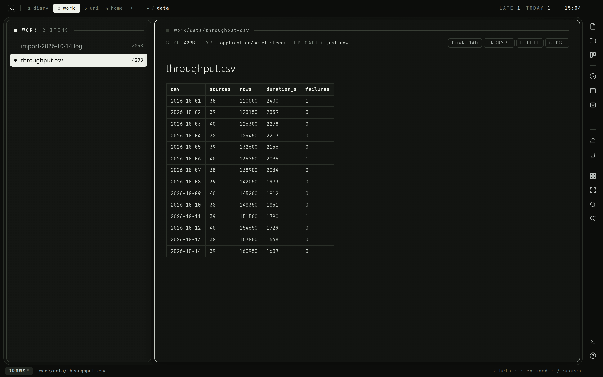
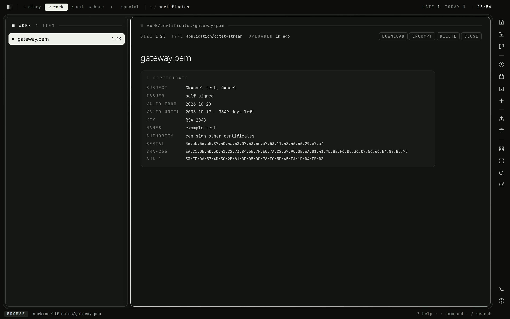
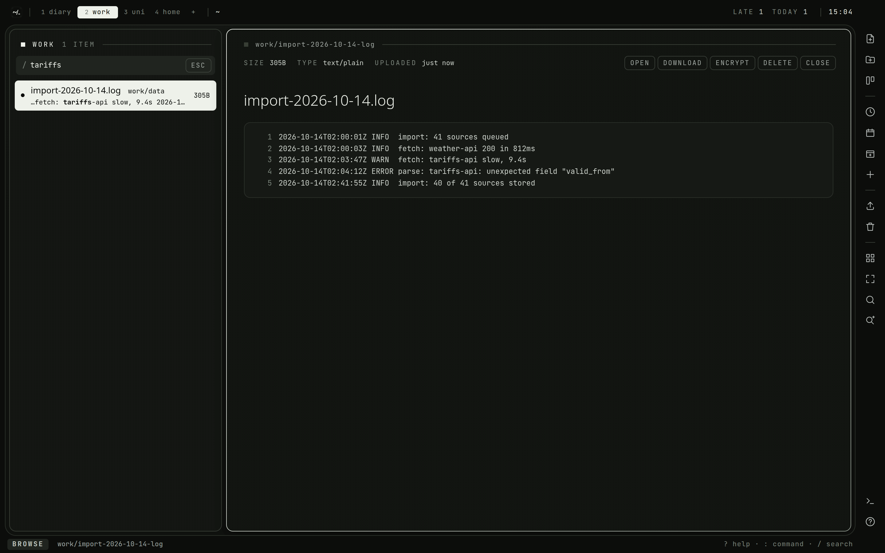

# Files and search

## Files

A file is a node like a document, only with bytes instead of text. It sits in a
folder beside the notes about it, shows its size in the list, and `Enter` opens
it.

Put files in:

- drop them onto the list;
- `:upload` picks files for the folder you are in;
- `:import` uploads a whole folder, and `:import!` a zip
  (see [Not losing things](Not-Losing-Things.md#import));
- copy them in over the [SFTP mount](SFTP.md).

Each upload is written to disk as it arrives, never held in memory, so the only
limit is `WORKSPACE_MAX_UPLOAD_MB` (1024 by default) per request.

### What opens in place

- images, video and audio;
- PDFs, in the browser's own viewer;
- text and source code of any kind, with line numbers, up to the first
  256 KiB;
- markdown, rendered, with `:source` to see it as written;
- CSV and TSV, as a table of the first 500 rows;
- certificates, keys and keystores (`.pem`, `.crt`, `.cer`, `.der`, `.csr`,
  `.key`, `.p8`, `.p12`, `.pfx`), read on the server.

A certificate shows its subject, issuer, validity, key, names, usage and
fingerprints, and which key belongs to which certificate. A `.p12` or an
encrypted key asks for its password, which opens it for that one look and is
not stored. Nothing of a private key is sent back but its algorithm and size.

Anything else is a download: `:download` (`:dl`) fetches the file under the
cursor, and `gx` opens it in a browser tab of its own. Files are renamed with
`:name`, moved like documents, and deleted into the trash with `x`.

Uploads are only ever served as types that cannot run in the browser. An HTML
file or an SVG, for example, downloads instead of opening.

## Search

| key | searches |
| --- | --- |
| `/` | the space you are in |
| `Ctrl-P` | every space |

Results appear as you type, ranked by relevance, each with the space and
folder it is in. `Tab` or `Ctrl-N` / `Ctrl-P` walk them without leaving the
line, and `Enter` opens the one lit. Afterwards `n` and `N` open the next and
previous result beside the list, and `:noh` clears the search.

Cards are searched too, by their title, description and checklist steps. They
are listed after the documents, under `cards`, with the board and list each is
on. `Enter` on one turns it over on its board; `n` and `N` only light it up.

Each word you type matches the start of a word, so `inge` finds "ingest". All
the words must be there. Punctuation is ignored, so a search of nothing else
finds nothing.

### Inside files

A search reads the text files in the tree as well as the documents. A file
counts as text by its type, or when its first 8 KiB read as UTF-8 with no NUL
byte, which covers `.log` files and Makefiles. The first 256 KiB of each is
indexed, the same part the viewer shows. A file found by its text shows the
words around the match under its name, with the words that matched lit.

The text is read when a file arrives, by upload, import or the SFTP mount,
again when its bytes change, and at start for any file still missing it. PDFs,
office documents and images are not read.

A sealed file is never indexed; see [The vault](Vault.md). Sealing a file drops
its text in the same step, and decrypting it reads it again.
