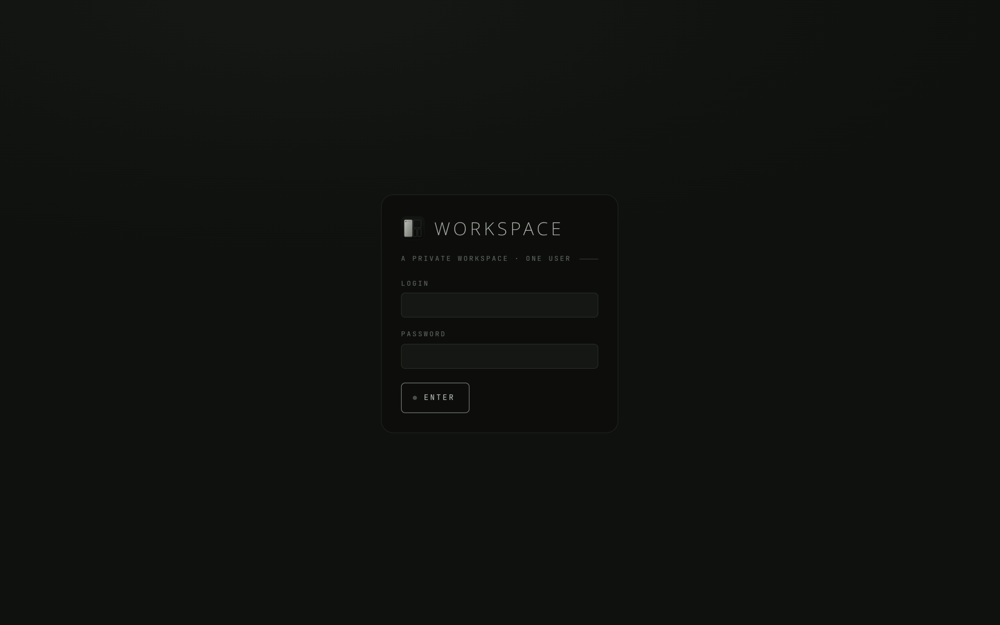
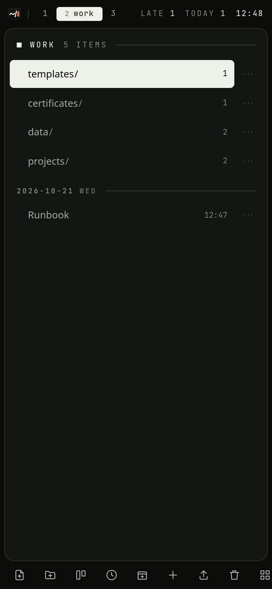

# Getting started

## Run it

You need Rust (1.96 or newer) and [bun](https://bun.sh) to build it. The result
is one binary with the whole frontend inside, so the machine it runs on needs
neither.

```sh
git clone https://github.com/narrrl/narl-workspace
cd narl-workspace
cp .env.example .env
```

Open `.env` and set three things:

- `WORKSPACE_USER`: the name you log in with.
- `WORKSPACE_PASSWORD`: the password. The server will not start while it is
  still `change-me`.
- `WORKSPACE_SECRET`: 32 random characters that sign the login cookie. Make
  one with `openssl rand -base64 32`.

Then build and start it:

```sh
make build
./target/release/narl-workspace
```

and open <http://127.0.0.1:4242>.

With Docker instead, `docker compose up -d --build` does the same; see
[Deploying](Deploying.md). Every other setting has a default that works on
your own machine. [Configuration](Configuration.md) lists them all.

## Log in



The workspace has one account, the one in `.env`. Wrong passwords are answered
more slowly each time. A browser that has logged in before is slowed only by
its own mistakes, so someone guessing from elsewhere cannot lock you out.

## Find your way around

A new workspace has three spaces: `diary`, `work` and `uni`. The bar along
the top shows them as numbered pills. `1`, `2` and `3` switch between them,
and `Tab` steps to the next one.

The screen has four parts:

- **the bar**, at the top: the spaces, where you are in the tree, how many
  cards are late or due today, and the clock;
- **the list**, on the left: what is in the folder you are in;
- **the tiles**, on the right: the documents and files you have open;
- **the status line**, at the bottom: the mode you are in, and what the last
  key or command did.

The rail of buttons on the right does the same as the keys, for a mouse.

## The first ten minutes

1. Press `2` to go to `work`.
2. Press `o`. A new document opens in the editor, in insert mode. Write
   something.
3. Press `Esc` to leave insert mode, then type `:name Plans for the week` and
   `Enter` to give it a name. There is no need to save: the document is saved
   a couple of seconds after you stop typing. `:w` saves at once anyway.
4. Type `:q` to close it. It is in the list now, under today's date.
5. Press `O` (capital). The command line opens with `:mkdir ` already typed;
   add a name and press `Enter`. `l` or `Enter` on the folder goes into it, and
   `h` comes back up.
6. Press `c`, type `try the board`, and press `Enter`. That is a card in the
   inbox of this space's board. Press `b` to see the board on the plan screen,
   `t` to put the agenda beside it, and `Esc` twice to go back to the documents.
   `S` goes to the plan and back; `Ctrl-h`/`j`/`k`/`l` walk between the tiles.
7. Press `T`. That is today's diary entry, started for you.
8. Press `?` for the list of every key and command. `h` / `l` walk its columns, `/` narrows it down, and `Esc` closes it.

On a phone the same things are buttons: the dock at the bottom has a new
document, a new folder, the board, today's entry, an upload and a search, and
the `⋯` on a row (or a long press on it) has what can be done to that row.
Over HTTPS the browser offers to install it as an app, which then sits in the
share sheet and puts what is shared on the scratchpad; see
[On a phone](Guide.md#on-a-phone).



## Next

[The guide](Guide.md) goes through a whole day with the workspace and
explains each part as it comes up.
