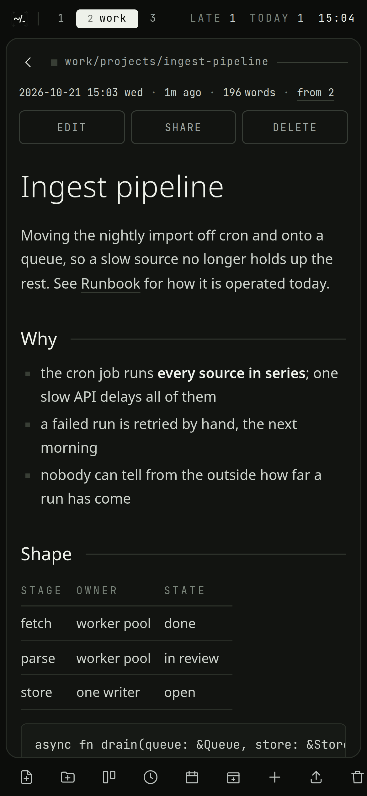

# The guide: a day with the workspace

This page follows one ordinary day: the agenda in the morning, notes and cards
at work, a lecture in the afternoon, a thought on the way home, and the diary in
the evening. Each part of the workspace is explained where it first comes up,
with a link to the page that has the rest of it.

The keys are the desktop's. On a phone, every one of these has a button; see
[On a phone](#on-a-phone) at the end.

## Morning: what needs you

The first time you open the workspace each day, the **agenda** opens by itself
when anything is late or due. Any other time, press `t`. It opens in the
**special workspace**, beside the board and the calendar; `S` puts that up and
away from anywhere, and `Tab` walks its tiles.


It gathers the unfinished cards of every board into four groups:

- **late**: past their due date;
- **today**: due today;
- **this week**: due in the next seven days;
- **in hand**: in a list between the inbox and done, which means work has
  started on them.

Under the cards it says whether the diary has an entry for today, and lists
what you wrote on this day in earlier years.

Walk it with `j` and `k`. On a card:

- `Space` finishes it, where it stands;
- `D` gives it a due date: `fri`, `tm`, `+3d`, `10-31`;
- `H` and `L` move it to the list left or right on its board;
- `Enter` goes to the card on its own board, in the tile beside.

`Esc` leaves the special workspace. The bar keeps showing the `late` and `today`
counts while either is above zero. More in [Boards and the agenda](Boards-and-Agenda.md).

## At work: spaces, documents and tiles

Press `2` for the `work` space. A **space** is one area of your life, with its
own folders, its own board and its own search. Make more with
`:space! <name>`; `w` shows all of them at once, with what was last written in
each.


The list on the left shows the folder you are in. `j` and `k` move, `l` or
`Enter` opens what is under the cursor, `h` goes up a level. Folders come first,
then documents grouped by the day they were written.

Open the project notes with `Enter`. To read a second document beside it, move
to it and press `L` instead: it opens in a **tile** of its own.


`Alt-h` and `Alt-l` move between the tiles and back to the list, `Alt-q`
closes one, and `f` makes the focused one fill the screen. Each space remembers
its tiles, so switching away and back finds them as they were. More in
[Spaces and documents](Spaces-and-Documents.md).

### Writing

`i` edits the open document. The editor is CodeMirror with real vim keys:
`ciw`, `dd`, visual mode, macros, `.` and the rest. `Esc` leaves insert mode,
and `:q` leaves the editor.


The document is markdown. Tables, code blocks, task lists and
math (`$x^2$`, or `$$…$$` on its own) are drawn when you read it. Link to
another document by its title, `[[Runbook]]`; typing `[[` offers the titles to
pick from. When the other document is renamed or moved, the link is rewritten
to follow it.

You do not need to save. Every keystroke goes to the browser's storage at
once, and to the server a couple of seconds after you stop typing. If the
network is gone, the draft waits in the browser and is sent when it comes back.
More in [Writing](Writing.md).

### Cards

In a meeting someone asks you to renew a certificate. Press `c`, type
`Renew the gateway certificate`, and `Enter`. The card is in this space's
inbox, and you have not left the document you were reading.

Press `b` to see the **board**, in the special workspace. A digit there
shows the board of another space.


The first list is the inbox and the last is done; the ones between are work in
hand. `h`/`l` move between lists and `j`/`k` between cards. `H`/`L` move a
card across, `Space` finishes it, `D` sets its due date, and `Enter` opens its
notes: a document made for the card the first time you ask. `:repeat weekly`
makes a card come back in the inbox each time it is finished. `q` goes back to
the tree.

### Finding things

`/` searches the space you are in, as you type. `Ctrl-P` searches every space.
The search reads the documents and the text files in the tree: a log file is
found by a line inside it, and the result shows the words around the match.


`Tab` walks the results without leaving the line, `Enter` opens one, and
`n`/`N` step through them afterwards. More in [Files and search](Files-and-Search.md).

## Afternoon: a lecture

Press `3` for `uni`. The lecture notes have formulas in them, written as
LaTeX between dollar signs and drawn by KaTeX:


The slides came as a PDF. Drop it onto the list, or `:upload`, and it is a
file in the folder, beside the notes about it. `Enter` opens a PDF, an image, a
video, a CSV table, a text or source file, or a certificate in place. Anything
else downloads with `:dl`.


A scan of something private, like an ID or a contract, goes in with
`:upload!` instead. That seals it in the **vault**, under a password that is
never stored. See [The vault](Vault.md).

## On the way home: capture

A thought arrives when no tab is open. `:token add phone` makes a token. With
it, an iPhone Shortcut, an Android HTTP Shortcut or a single `curl` puts a card
in an inbox, or a line in today's diary entry:

```sh
curl -H "Authorization: Bearer nwc_…" -H 'content-type: application/json' \
  -d '{"text":"call the bank"}' https://your-host/api/capture
```

The token can do this and nothing else. See [Capture](Capture.md).

## Evening: the diary

Press `T` for today's entry. If there is none yet it is started, from the
diary's `templates/day` document when there is one, and opens ready to write.

`C` shows the diary by month. A dot marks a day with an entry; `h`/`l`,
`j`/`k` and `H`/`L` move by day, week and month, and `Enter` opens the day,
or starts an entry for it. In an entry, `[d` and `]d` step to the one before
and after.


If nothing was written in the diary by the evening and mail is set up, a
reminder arrives at `WORKSPACE_REMINDER_AT`. More in [The diary](Diary.md).

## When something goes wrong

- **Deleted the wrong thing?** `u` brings the last delete back. `:trash` lists
  everything deleted in the last 30 days.
- **Overwrote a paragraph?** `gh` lists the document's earlier versions as diffs
  against the text as it is now, and `Enter` brings one back.

  

- **Saved in two places?** A document saved somewhere else since you opened it
  is not overwritten: `:w` says so, `:e!` takes the other version, and `:w!`
  writes yours anyway.

More in [Not losing things](Not-Losing-Things.md).

## On a phone

On a touch screen the workspace drops the modal keys, and under 768 pixels
wide the list and the open document take the whole screen in turn. A dock along
the bottom has a new document, a new folder, the board, today's entry, an
upload, the trash and a search. The `⋯` on a row, or a long press, has
everything that can be done to it: rename, move, share, seal, delete. The agenda
has a done button on each card.

| | |
| --- | --- |
|  |  |

`:set vim` turns the vim keys on for a phone with a keyboard.
