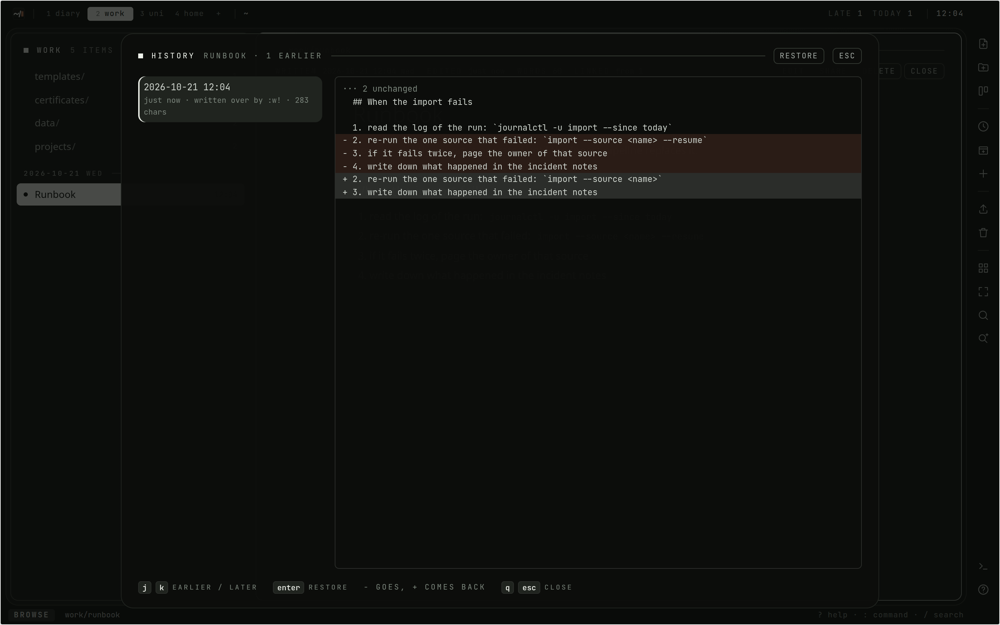

# Not losing things

The workspace is meant to be the one place things are kept, so it tries hard
not to lose any of them. This page covers what protects your work, and how to
get it back.

## Saving

Each change is written to the browser's storage as it is typed and to the
server a couple of seconds later. A dropped network, an expired session or a
crashed tab does not lose a draft, and a save from elsewhere is not overwritten
without asking. See [Writing](Writing.md#saving).

## History

A save keeps the text it replaces. `gh` or `:history` lists the open document's
earlier versions, the newest first.

The version under the cursor is shown as a diff against the text as it is now:
`-` is what bringing it back would take out, `+` what it would put back. `Enter`
brings it back, and the text it replaces becomes a version of its own, so a
restore can be undone the same way.

- Autosave writes every few seconds, so an ordinary save keeps a version at
  most every ten minutes.
- `:w!`, a save over the SFTP mount, a link rewritten by a rename, and a
  restore always keep one, because each of them may undo something.
- A rename alone keeps nothing.
- The daily sweep forgets versions older than `WORKSPACE_REVISION_DAYS`
  (90 by default), but always keeps the newest 20 of each document.
- An upload is kept as long as a version still embeds it. A file that has been
  sealed since is gone from the old version, because sealing deletes the
  plaintext on purpose.

## The trash

A delete is not final. `x`, `dd`, `:delete`, `:rmspace` and an `rm` over the
mount put what they delete in the trash, with everything inside it.

- `u` puts the last delete back where it was: the same folder, the same name,
  unless a new one took the name meanwhile.
- `:trash` lists everything in it, the last deleted first. `j`/`k` walk it,
  `Enter` or `r` restores, `x` deletes one for good, and `:trash purge`
  empties it. Each of these asks first.
- Something whose folder has gone since comes back to the root of its space.
  Something whose space is in the trash too waits until the space is restored.
- After `WORKSPACE_TRASH_DAYS` (30 by default) the daily sweep deletes it for
  good, files and all.

While it is in the trash, a node is out of sight: not in the tree, the search,
the agenda, the mails, the SFTP mount, the export or the readable view on
Proton Drive. A card whose notes are in the trash finds them again after a
restore, and a shared document answers like an unknown link until it is
restored, with the same link its readers already have.

## Export

- `:export` downloads the open document as markdown.
- `:export!` downloads the whole workspace as a zip.

The zip needs nothing from this application to be read: the tree as real
directories, one markdown file per document, every file where it sits, every
embedded upload in `media/`, all under their real names, with relative links
between them. What plain files have no place for (when each entry was written,
names as they were typed, which space is the diary, the boards with their cards
and rules) goes into one `.workspace.json` beside them.

`:export!` refuses while the vault is shut, because the archive has to hold the
sealed files opened.

## Import

- `:import` picks a folder and uploads it into the one you are in. Directories
  become folders, `.md` and `.markdown` files become documents (named by their
  first heading), and anything else becomes a file.
- `:import!` does the same with a zip.
- `:import! /` pours an `:export!` back in at the root. Each directory becomes a
  space again, or goes into the space already there by that name, and with
  `.workspace.json` the dates, names, boards and cards come back as they were.

Links between imported files are rewritten as they land: a link to a markdown
file becomes the document's address, a link to an image its upload. Anything
pointing outside the upload is left as it was. Absolute paths, `..` and
anything else a zip might smuggle in are refused.

## Backups

The data directory, `WORKSPACE_DATA_DIR`, is the whole backup: `diary.db`
and `uploads/`. Before a new build changes the database it copies it to
`diary.db.pre-<version>` next to it. The server can also mirror itself to
Proton Drive, end-to-end encrypted; see [Backup and mail](Backup-and-Mail.md).
