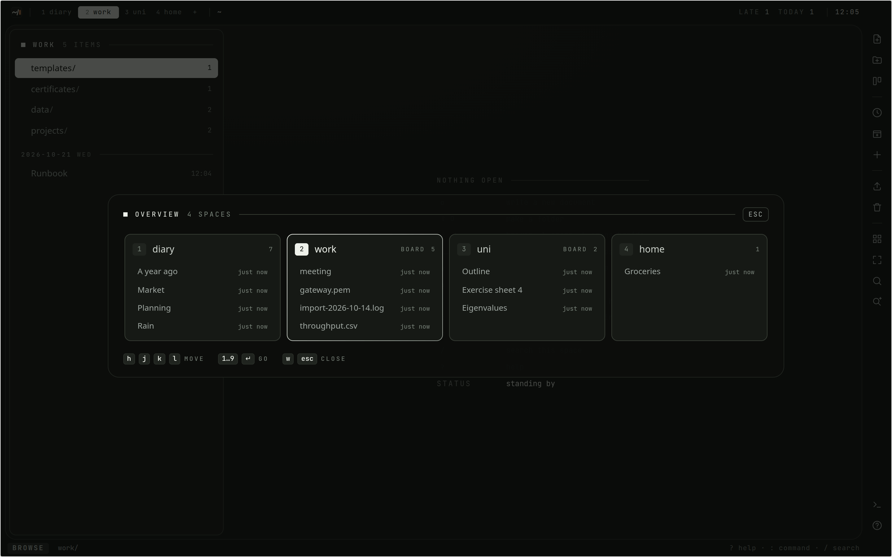

# Spaces and documents

## Spaces

A space is a top-level area: `diary`, `work`, `uni`, or whatever you make.
Each has its own tree of folders, its own board and its own search, so work and
uni do not get mixed up.

- `1` … `9` and `0` switch to a space by its place in the bar; `Tab` and
  `Shift-Tab` step through them.
- `w` shows every space at once, with what was last written in each. `hjkl`
  move, `Enter` goes there.
- `:space! <name>` makes a space, `:name! <name>` renames the one you are in,
  and `:rmspace` puts it in the trash with everything in it. Two spaces cannot
  share a name, whatever the case.
- `:set noboard` turns the board off for a space, `:set board` back on.

One space has the **diary** role. It is the diary by role, not by name: rename
it and the reminder and the agenda still know which space it is. It cannot be
deleted. See [The diary](Diary.md).

## The tree

Inside a space, folders nest to any depth. The list shows the folder you are
in: folders first, then documents and files, grouped by the day they were
written.

| key | what it does |
| --- | --- |
| `j` / `k`, `gg` / `G` | move, first, last |
| `l`, `Enter` | open the document or file, or go into the folder |
| `h` | up one level |
| `o` | a new document here, straight into insert mode |
| `O` | a new folder here |
| `R` | rename what is under the cursor |
| `x`, `dd` | delete it, into the trash |
| `u` | bring the last delete back |

`:cd <folder>` walks the tree from the command line (`:cd ..` goes up, `:cd /`
to the root of the space), and `:mkdir <name>` makes a folder.

### Moving things

- `m` picks up the row under the cursor; `m` again puts it back. `M` picks up
  the whole folder you are in.
- Walk to another folder, in any space, and press `p` to drop everything picked
  up there.
- `Shift-1` … `Shift-9` sends what is picked up, or the row under the cursor,
  straight to the root of that space.
- `:mv <folder>` moves it into a folder here, `:mv ..` up one level, `:mv /`
  to the root.
- With a mouse, `Ctrl`-click picks a row up and `Shift`-click every row from
  the cursor to it; drag them onto a folder, a crumb in the bar, or a space.

A move never breaks a link: every document that links to what moved is
rewritten to point at its new place. See [Writing](Writing.md#links).

## Documents

A document is markdown with a name. It has a real address,
`/n/<space>/<folder>/<slug>`, which the address bar shows and which can be
linked to from anywhere behind the login.

The line under the title says when it was written and last edited, how many
words it has, and how many documents link to it. In the reader:

| key | what it does |
| --- | --- |
| `j` / `k`, `Ctrl-D` / `Ctrl-U` | scroll a line, or half a page |
| `]]` / `[[` | the next / previous heading |
| `gO` | the headings as a list to jump to |
| `zl` / `zh` | scroll a wide table or code block sideways |
| `F` | a letter over every link and button in view; type it to follow |
| `gh` | earlier versions |
| `gb` | the documents that link here |
| `i`, `a` | edit |
| `q`, `Esc` | close |

`:stats` counts words and lines, `:copy` puts the whole text on the clipboard,
`:export` downloads it as a `.md` file, and `:date 2026-10-01` changes the day
it is filed under.

A document made with `o` and left with neither a name nor a word in it is
removed again when you leave it, so abandoned starts do not pile up.

## Tiles

Several documents can be open at once, each in a tile of its own.

- `L` or `Shift-Enter` on a row opens it in a new tile; `Enter` and `l` open
  it in the focused one.
- Tiles share the space the way a tiling window manager does: two side by side,
  a third splits the newer one, and so on.
- `Alt-h/j/k/l` moves the focus between tiles, and `Alt-h` past the leftmost
  goes back to the list. `Alt-Shift-h/j/k/l` moves the tile itself.
- `gt` / `gT` (or `:bn` / `:bp`) cycle through them, `:ls` lists them, and
  `:b <n or name>` focuses one.
- `Alt-q` (or `:close`) closes the focused tile, `:only` every other one, and
  `f` makes the focused tile fill the screen.

Opening a document that is already in a tile focuses that tile rather than
opening it twice. Each tile keeps its own scroll position and editor, and each
space remembers its tiles. Under 768 pixels wide only the focused tile is
shown.
