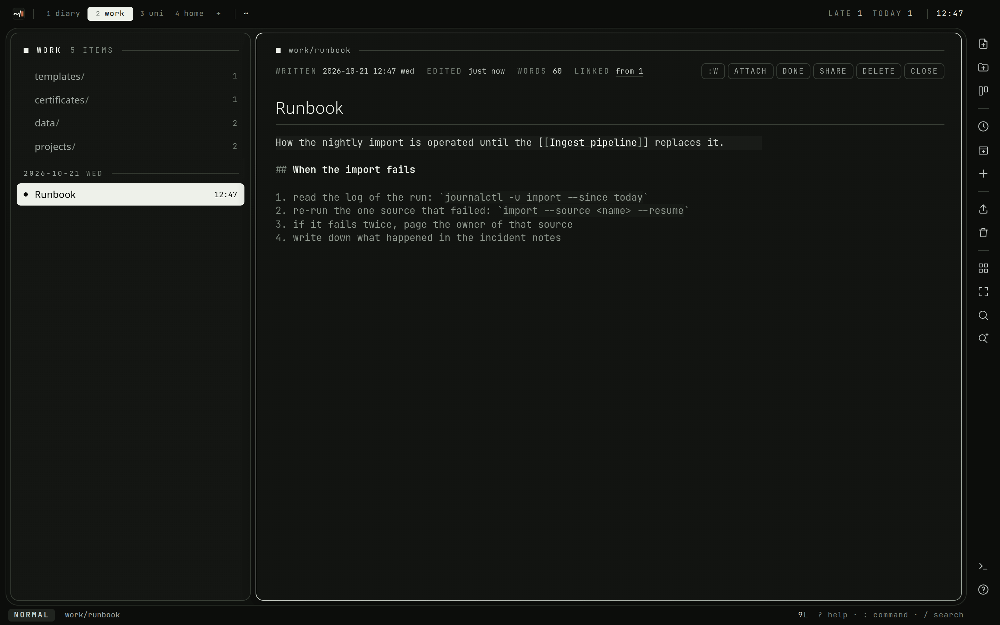
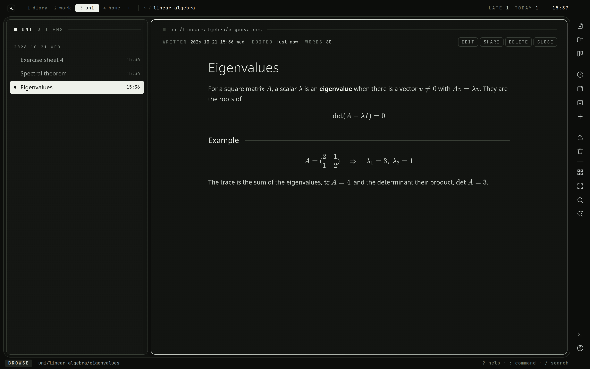
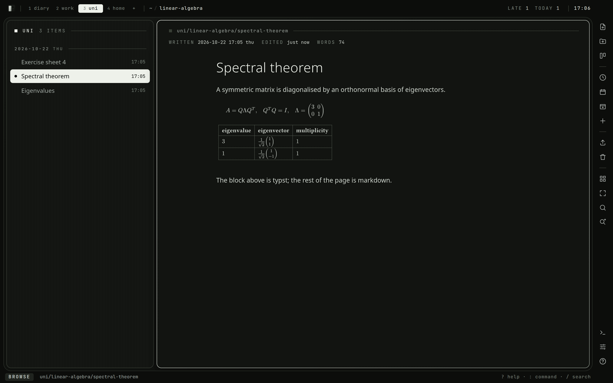

# Writing

## The editor

`i` or `a` on an open document edits it. The editor is CodeMirror 6 with the
vim keymap: motions, operators, text objects, visual mode, registers, macros
and `.` all work. It is the one editor in the app: a card's description and a
note in the scratchpad are written in it too, and behave the same way.

- What is written saves itself (see [Saving](#saving)); `:w` saves sooner.
- `:q`, or `Esc` in normal mode, leaves the editor with what is still waiting
  written first. Where that fails, the text stays on screen. `:wq` is the same.
- `:q!` leaves and lets go of what is not saved yet.
- `[[` offers the titles of documents as you type, in a description or a note
  as well as a document.



- `:name` on its own moves up into the title; `Enter`, `Esc` or `↓` goes back
  down into the text. `:name <text>` renames without leaving the text.
- `]]`, `[[` and `gO` walk the headings, the same as in the reader.
- `gf` follows the link under the cursor, saving first, and `gx` opens it in
  a new browser tab.
- `Ctrl-S` saves from anywhere, and `?` shows the help.
- Yanks and deletes go to the system clipboard too. `:set noclipboard` keeps
  them in vim's registers only.
- `:set novim` turns the vim keys off for a plain editor; `:set vim` turns them
  back on. On a touch screen they start off.

Drag, drop or paste an image, a video or a sound file into the text and it is
uploaded and embedded where the cursor is. `:upload` picks files to embed. Each
one becomes a file of the document: it moves, seals, goes to the trash and
comes back with it. `:info files` lists them: `Enter` opens one, `i` embeds it
at the cursor, `y` copies how to embed it in another document. In the list a
document with files says `+2`, and `za` folds them open under it.

## Saving

There is nothing to remember. Each change goes to the browser's storage as it is
typed, and to the server a couple of seconds after typing stops. A card's
description and a note are kept the same way, and the first three cases below
hold for them too.

- When the server cannot be reached, the draft stays in the browser and the
  save is tried again, less often the longer it fails, and at once when the
  browser says it is back online.
- When a session runs out in the middle of a sentence, the login appears, and
  logging in again carries on where it stopped, draft and all.
- When a tab dies in the middle of a document, opening the document again
  restores the draft and says so. `:e!` throws the draft away.
- When the document was saved somewhere else since you opened it (another tab,
  the phone, the SFTP mount), `:w` says so instead of overwriting it. `:e!`
  takes the other version, and `:w!` writes yours anyway.

Each save keeps the text it replaces, so nothing written is lost. See
[Not losing things](Not-Losing-Things.md#history).

## The scratchpad

Not every note knows yet where it belongs. `Q` (or `:scratch`) lowers the
scratchpad from under the bar, over whatever is on screen, the way the
desktop lowers its own; `Q`, `q` or `Esc` raises it again, and what was on
screen is as it was. `Ctrl-Q` works from anywhere, the editor included: the
scratchpad comes down with the last note being written, at its end, and
`Ctrl-Q` again puts it away and goes back to the document, still writing where
it was left. Firefox quits on `Ctrl-Q`, so there it is `Q` only. Its notes have no name, no space and no folder: a note is
a body and the time it was last touched, newest on top.

| key | what it does |
| --- | --- |
| `j` / `k`, `gg` / `G` | down / up the notes |
| `o` | a new note, written straight away |
| `Enter`, `e`, `i` | write the note under the cursor |
| `K` | keep it: a document in the folder being browsed (`:keep [title]`) |
| `C` | make it a card, where `:card` puts one: the first line its title, the rest its description |
| `A` | put it at the end of a document (`:append [document]`) |
| `dd` | drop the note (asks y/N) |
| `Q`, `q`, `Esc` | raise the scratchpad |
| `Ctrl-Q` | from anywhere, while writing too: down with the last note being written, and back again |

A note is written in the same editor as a document, and saves itself the same
way. `Esc` in normal mode, or `:q`, goes back to the notes; a note left empty is
not kept.
`:scratch <text>` takes a note from the command line without lowering the
drawer.

Keeping a note makes it a document in the folder the tree is showing, and
takes it off the scratchpad. Its first line is the title — `# Plan` or plain
`Plan` alike — and the rest the body; `:keep <title>` names it instead and
keeps every line. The document opens, and the drawer goes up.

`C` makes the note a card on the list under the board's cursor, or in this
space's inbox. `A` opens `:append` with the document on screen filled in;
change it to any document's title — `Tab` completes it — and `Enter` puts the
note at its end, as a paragraph of its own. The document's text before is kept
in its history. Either way the note leaves the scratchpad, as it does with `K`.

`/` finds notes too, listed under `notes` after the documents and the cards;
`Enter` on one lowers the scratchpad with it under the cursor.

The notes are in the backup, and an export of the whole workspace carries
them in `.workspace.json`, so `:import zip /` puts them back.

## Markdown

Documents are GitHub-flavoured markdown: headings, lists, task lists, tables,
quotes, code blocks and links. A single line break is kept as a line break,
the way it was typed, with one exception: a paragraph that an editor wrapped
at a fixed width, as imported notes and files saved over the SFTP mount often
are, is read as the running text it is. A break asked for outright, with two
spaces or a `\` at the end of the line, is always kept.

A fenced block that names its language — ` ```rust `, ` ```python `, ` ```sh ` and
the rest CodeMirror knows — is coloured the way nvim's `yorha` theme colours it:
keywords in sand, strings in moss, numbers in heather, types in dusk, comments
muted and italic. The editor colours it the same as it is written.

Math is set by KaTeX:

- `$x^2$` inline;
- `$$ … $$` on lines of its own, or a ` ```math ` block, for a display formula.



### Typst

A ` ```typst ` block (or ` ```typ `) is set by [Typst](https://typst.app) on
the server and shows as an image where it stands: math, tables, figures,
anything typst lays out. It shows its source while it is being set, and the
error typst gives, with the line of the block, when it cannot be.

- The page fits what is on it and is transparent, and the text is the
  theme's. `#set page(width: 15cm)` makes a block of prose wrap, and any other
  `#set` changes what it says.
- A block is typeset with nothing but itself and the fonts built into the
  binary: `#import "@preview/…"` and `#image("…")` are refused.
- On a share page the blocks are set too, for the reader holding the key, and
  only blocks the shared document holds.



## Links

A document links to another in two ways:

- by its address: `[the plan](/n/work/notes/plan)`;
- by its title: `[[Plan]]`, or `[[Plan|the plan]]` with a label of its own.

A title is looked for in the space the link is written in first, then in every
other. It matches a name in any case, or the slug of that name. Typing `[[` in
the editor offers the titles of documents as the search finds them. A title
that no document has yet is drawn dimmed, and following it offers to write that
document.

Links keep working when what they point at moves. Renaming a document, or a
folder above it, or moving either, rewrites the links to it in every document
that has one, in the same save: the path to the new one, a `[[title]]` to the
new name, the label left as it was. A link to something in the trash follows it
when it is restored; once it is deleted for good the link text stays and leads
nowhere.

`gb` or `:backlinks` lists the documents that link to the open one, each with
the line it does so on.

A link written inside a card, or a bare address in prose rather than a markdown
link, is not counted or rewritten.

## Templates

Any space can have a folder called `templates` at its root. Every document in
it is a template.

- `:new meeting` starts a document from `templates/meeting`. `Tab` completes the
  template names.
- `:new meeting 2026-10-20 Budget` dates it and names it as well.

In a template these placeholders are filled in, on the clock of
`WORKSPACE_TIMEZONE` at the date the document is for:

| placeholder | becomes |
| --- | --- |
| `{{date}}` | `2026-10-20` |
| `{{weekday}}` | `Tuesday` |
| `{{time}}` | `14:05` |
| `{{title}}` | the new document's name |

A new diary entry starts from the diary's `templates/day` when there is one.
See [The diary](Diary.md).
